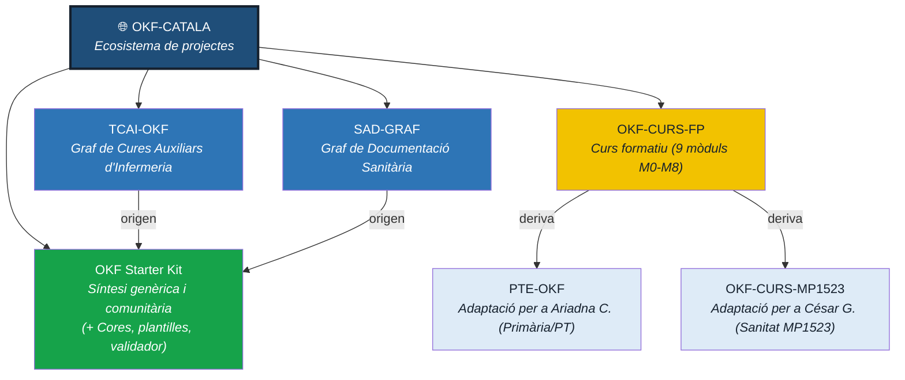

# Filosofia d'OKF

> *«No habitem en carpetes burocràtiques; habitem en xarxes de significat.»*

Aquest document explica el per què d'OKF abans del com. Si només vols posar-te a treballar, salta a [`04-inici-rapid.md`](04-inici-rapid.md). Però si t'interessa entendre d'on surt cada decisió, aquí hi ha la història completa, explicada en primera persona i sense maquillatge.

**DOI:** [10.5281/zenodo.23823819](https://doi.org/10.5281/zenodo.23823819) · **Repositori:** [github.com/jmonta23-okf/okf-starter-kit](https://github.com/jmonta23-okf/okf-starter-kit)

---

## 1 · La programació didàctica és un organisme viu, no un fòssil administratiu

Soc biòleg de formació i vaig néixer el 1974. Abans de ser docent vaig treballar a la indústria farmacèutica, en control microbiològic. Era un món de protocols estrictes, on el rigor i la traçabilitat no eren una opció: si una cosa no estava escrita, validada i es podia reconstruir pas a pas, no existia. Aquell hàbit no se'n va mai.

El 2015, sent interí, em va tocar el «marró» del mòdul de Codificació Sanitària, el que ningú volia per la seva complexitat. Me'l vaig agafar com un repte. Treballant amb ontologies i classificacions mèdiques com SNOMED-CT i la CIM-10 vaig veure una cosa que no he pogut deixar de veure des de llavors: cap concepte viu sol. Cada terme penja d'un altre, hereta d'un tercer i s'especialitza en un quart.

I llavors em va caure la fitxa: **el currículum educatiu funciona d'una manera molt semblant.** No és una llista lineal de Word. És una xarxa viva de conceptes (activitats, criteris d'avaluació, rúbriques) que es relacionen entre ells. És una analogia i no una identitat, però és prou bona per canviar la manera de treballar.

L'especificació **Open Knowledge Format (OKF)** de Google Cloud, publicada el juny de 2026, va ser el punt de partida formal. La seva idea —un format obert perquè els agents d'IA compressin coneixement estructurat en Markdown + YAML— em va fer veure que el currículum es podia governar amb la mateixa arquitectura. Aquest kit és un **perfil** d'aquella especificació, adaptat a l'educació: respecta el nucli (el camp `type`) i afegeix 9 tipus i 8 camps universals per a la governança curricular. No calia inventar un format nou: n'hi havia prou d'adaptar-ne un d'existent i afegir-hi la capa educativa.

Per això convé distingir dues coses que sovint es barregen:

| | Què és | Com és |
|---|---|---|
| **Currículum oficial** | El decret | Fixat per l'administració. El canvia qui té la competència per fer-ho, no pas nosaltres, i el respectem tal com és. |
| **Programació didàctica d'aula** | El que en fem a l'aula | Un organisme viu: canvia cada curs, cada grup, cada setembre. |

**El graf de Markdown és la programació viva.** El document que lliurem a Inspecció és una *fotografia*, una vista derivada que generem quan toca complir el tràmit i que revisem abans de lliurar-la, perquè el que arriba a l'administració ha de ser fidel al que fem de debò. La feina real viu al graf; el paper n'és el reflex.

---

## 2 · Sobirania: el coneixement és teu i camina a la teva motxilla

Massa vegades la feina d'un docent queda atrapada en plataformes privatives. Hi passes cursos construint materials, i el dia que canvies de centre, o que la plataforma canvia de condicions, descobreixes que no ets propietari de res. Anys de criteri professional tancats darrere d'un compte que no controles.

OKF defensa tres pilars:

1. **El coneixement professional al teu propi equip.** L'estructura, el criteri i els materials que has treballat són en fitxers que tens tu, no en el núvol de ningú.
2. **El text pla.** Cap format és etern, però el text pla és el que millor resisteix el pas del temps i els canvis de programari. Markdown es pot llegir amb qualsevol editor.
3. **El professional abans que la institució.** Et beneficies tu primer. I de retruc, se'n beneficia el centre: quan marxes, el traspàs és net, perquè el teu coneixement és ordenat i portable per naturalesa. Parlo del coneixement professional (criteri, estructura, manera de treballar) i no dels documents oficials del centre, que segueixen les seves pròpies regles.

Aquesta sobirania és del **coneixement**, no dels models. Treballem amb models de llenguatge que no controlem. El que sí controlem és que el que hem construït estigui en un format que es pot dur a un altre model, o a cap.

---

## 3 · El factor Montse i el Taller d'Artesania (MIAE + VCER)

L'agost de 2026 vaig muntar el graf del cicle TCAI i vaig començar a operar-lo amb IA, amb bateries de *prompts* cada vegada més elaborats. Els passava a la Montse G., la meva co-docent del torn de tarda. I ella s'atabalava.

Era perfectament normal. El meu sistema fallava, i fallava per culpa meva: havia donat per fet que els companys havien de tenir el meu perfil tecno-friqui. No és així, ni té per què ser-ho.

D'aquí va néixer el **Paquet LLM**, pensat per cuidar la Montse. Vaig encapsular les instruccions en una recepta oberta, transparent i en text pla. Ella la pot llegir, entendre què li demanem a la IA a cada pas i adaptar-la: si una línia no li serveix, la retalla; si en falta una, l'afegeix. Ella és la veritable usuària del sistema, i de moment anem harmonitzats matí i tarda sense angoixa tecnològica.

El taller, a més, no treballa amb qualsevol eina. Hi ha dos marcs de referència que ens guien:

- **MIAE (Nivell 3).** Marc de Juan José de Haro que descriu com es reparteix el treball entre la persona i la IA. Al nivell 3, la IA proposa un esborrany i el docent el reconstrueix significativament: l'esborrany és això, un esborrany, i el docent és qui el decideix i el signa.
- **VCER** (*Vibe Coding Educatiu Responsable*). Aposta per artefactes d'aula 100% offline, privats i lliures. Parlo dels materials que en resulten: allò que arriba a l'aula funciona sense dependre de cap servei extern.

I una norma de sentit comú que ens posem: **dades personals de l'alumnat, ni al graf ni als *prompts*.** El graf guarda l'estructura i els models de treball, mai persones.

**Què s'envia al model, exactament?** El text que s'envia al model és el contingut del graf: currículum, activitats, criteris d'avaluació. **Mai dades personals de l'alumnat.** Si el graf conté adaptacions individuals (per exemple, un Pla de Suport Individualitzat), cal anonimitzar-les abans de passar-les al model. El VCER garanteix que els materials generats són 100% offline, però el procés de generació sí que passa per un model al núvol (o local, si es tria un model d'execució local). Els detalls complets són a [Relació amb estàndards](./08-relacio-amb-estandards.md) i a la [Plantilla PaquetLLM](../04-plantilles/PLANTILLA-PaquetLLM.md).

### Declaració d'ús d'IA en aquest kit

Aquest kit s'ha desenvolupat en **cocreació amb models de llenguatge**, i ho declara explícitament per coherència amb el que exigeix als materials que genera.

**Nivell MIAE declarat: 4 (cocreació).** No és Nivell 3 (esborrany IA + reconstrucció) perquè el diàleg ha estat continu i bidireccional: l'autor ha posat la visió, la filosofia, el domini, els casos reals i les decisions ètiques; la IA ha generat esborranys, ha proposat estructures i ha comès errors que l'autor ha detectat i corregit. No és Nivell 5 (autonomia de la IA) perquè les decisions crítiques sempre han estat humanes: què s'inclou, què s'exclou, quin to, quins casos, quins límits.

**La distinció és important:** el nivell 3 és el que proposem per als materials d'aula (la IA fa l'esborrany, el docent el reconstrueix). El nivell 4 és el que té el kit mateix com a obra (la IA i l'autor han cocreat el text, amb l'autor prenent les decisions finals).

**Exemples d'aquesta cocreació:**
- La IA va proposar una primera versió del `01-casos-us.md` que era massa "de màrqueting". L'autor la va reescriure en primera persona, amb "Què en trec" i amb límits honestos. Aquesta versió és millor, i és la que hi ha al repo.
- La IA va cometre errors recurrents en els enllaços relatius (`../../` en lloc de `../`). L'autor els va detectar amb un `grep` i els va corregir.
- La IA va proposar canviar les versions `V1.0-Esborrany` dels nodes d'exemple. L'autor va detectar que era un error (són els valors per defecte que l'usuari ha de canviar) i ho va aturar.

**Relació amb VCER:** els materials generats amb IA en aquest kit compleixen els quatre pilars del *Vibe Coding Educatiu Responsable* (privacitat, offline, accessibilitat, llicència lliure). La declaració MIAE és el costat del procés; VCER és el costat de l'artefacte.

**Aquesta declaració és viva:** si en el futur es fa servir IA d'una manera diferent (per exemple, per generar nodes sencers de manera autònoma), el nivell MIAE s'actualitzarà i es documentarà aquí.

---

## 4 · Una proposta de sistema operatiu: l'ordre que fa lliure la ment

OKF no és un programa que s'instal·la. És una **capa d'abstracció**: una manera d'organitzar el coneixement sobre la qual altres coses es poden construir, de la mateixa manera que el web va esdevenir una capa sobre la qual es va construir tota la resta, tal com va plantejar Tim O'Reilly.

Si fem servir la metàfora d'un sistema operatiu, el paral·lelisme és aquest:

| Sistema operatiu | OKF |
|---|---|
| Kernel | **Cores** |
| API | **YAML + Validador** |
| Drivers | **Plantilles** |
| Aplicacions | **Paquets LLM** |

Els Cores són el nucli estable (els detalls, a [`03-arquitectura.md`](03-arquitectura.md)). El YAML i el validador defineixen el contracte que fa que els nodes encaixin. Les plantilles adapten el sistema a cada tipus de contingut. I els Paquets LLM són les aplicacions que el docent fa servir al dia a dia.

Com qualsevol metàfora, aquesta té un límit: un sistema operatiu fa complir les regles, i OKF només les proposa i, com a molt, les comprova.

---

## 5 · Transparència on es pot, verificació on no

Seria fàcil escriure aquí que OKF no té cap caixa negra. No seria cert, i seria poc honest. Un model de llenguatge és opac per naturalesa: no podem veure per què genera una resposta i no una altra, i amb la mateixa instrucció pot respondre diferent demà.

Per això cal separar dues coses.

**El que és transparent, i ho és de debò, és tot el que hi posem nosaltres:**

- Els Paquets LLM són receptes obertes, transparents i en text pla. El docent les llegeix, les entén i les modifica retallant o afegint una línia.
- Els nodes del graf són text pla.
- El validador és un script de Python d'unes 900 línies que qualsevol persona amb curiositat pot llegir.

**El que no és transparent és el model que executa la recepta, i d'això ens protegim, no ho dissimulem.** Vinc del control microbiològic, i allà tampoc no obries la incubadora per saber si funcionava: la qualificaves, hi posaves controls i ho registraves tot. Aplico el mateix criteri:

1. **Instruccions explícites i versionables.** Si el resultat canvia, pots comparar què li havies demanat.
2. **Validació de l'estructura.** Quan el resultat no compleix la forma que toca, el validador t'assenyala **on** és l'error i **per què**, no et diu simplement «alguna cosa ha fallat».
3. **Supervisió humana.** L'última paraula és sempre d'una persona que coneix la matèria.

I cal dir també què no pot fer el validador: **comprova la forma, no la veritat.** Un codi CIE-10 pot tenir un format perfecte i no existir. Aquesta darrera verificació només la pot fer algú que domina l'àmbit, i per això el docent no és prescindible.

La transparència d'OKF és la de la recepta i la de l'ofici. La del model no la tenim, i el que fem és no fer veure que sí.

---

## 6 · La solidaritat del gremi i l'antídot a la sobreenginyeria

OKF s'ha fet sobretot en solitari, al meu despatx, en caps de setmana i vacances. Els companys coneixen els vaults, però la majoria els mira com qui mira jeroglífics, i ho entenc. Només amb qui ha mostrat interès he fet proves, i amb calma. No és una mostra estadística ni pretén ser-ho: són proves artesanals que ens diuen on grinyola.

- **Benet M.**, un amic novell a la docència. Li vaig muntar un mòdul sencer de Química, una matèria que jo no domino, per veure si l'estructura aguantava fora de la meva zona de confort.
- **Ariadna C.**, mestra d'educació especial. Mirem amb ella com el graf pot ajudar a estructurar Plans Individuals i adaptacions (el model de treball, no les dades de l'alumnat).
- **César G.**, company de Sanitat.

I ara, la confessió clau: **els meus propis vaults de TCAI i SAD pateixen de sobreenginyeria.** Em vaig obsessionar. Quan tens la tendència de voler millorar contínuament, arriba un moment en què el sistema pesa més que la feina que hauria d'alleugerir.

L'**OKF Starter Kit** neix justament d'aquesta autocrítica. És una operació de neteja: ho he reduït tot a l'os, a la mínima expressió que aguanta el sistema, perquè sigui compartible. El que no hi ha, ho afegirà cada docent a mida.

Allibero el codi amb **doble llicència (MIT / CC BY-SA 4.0)** per trobar altres docents amb la mateixa mania i valorar plegats si això mereix continuar. Qui redescobreix pel seu compte el que un altre ja ha descobert perd un temps que no li sobra: compartir-ho és estalviar-se camí, i que el coneixement no es perdi cada setembre.

---

## 7 · Els orígens del sistema (Genealogia i ecosistema)

L'OKF Starter Kit no ha nascut de zero. És la síntesi de dos projectes reals (TCAI-OKF i SAD-GRAF), treballats a l'aula, que formen part d'un ecosistema més ampli: **OKF-CATALA**.

### L'ecosistema OKF-CATALA

OKF-CATALA és el conjunt de projectes que comparteixen la mateixa filosofia i les mateixes eines (Cores, plantilles, validador, Paquets LLM). No és un producte únic: és una **família de projectes** que creixen en paral·lel, cadascun amb el seu abast i el seu públic.



### Els dos orígens directes del kit

- **TCAI-OKF** és el graf del cicle TCAI (Cures Auxiliars d'Infermeria). És on va néixer el Paquet LLM i on vaig aprendre el factor Montse. És el projecte que comparteixo amb la Montse G.
- **SAD-GRAF** és l'altre graf d'origen (Documentació Sanitària). Com el de TCAI, va acabar patint de sobreenginyeria, i és el que em va fer veure la necessitat de simplificar.

De la fricció entre tots dos en va sortir el que realment importa: **un esquelet mínim, genèric i obert**.

### El curs formatiu i les seves adaptacions

- **OKF-CURS-FP** és el curs formatiu de 9 mòduls (M0-M8) que vaig dissenyar per ensenyar el sistema a altres docents. És el que va fer servir en César G. per crear el seu propi vault (adaptat al MP1523), i el que va fer servir l'Ariadna C. per adaptar-lo a Pedagogia Terapèutica.
- **PTE-OKF** és una **adaptació d'OKF-CURS-FP** per a l'Ariadna C.: un vault de Pedagogia Terapèutica amb privacitat reforçada per a dades de menors. No és un origen del kit: és un producte de l'ecosistema.
- **OKF-CURS-MP1523** és una altra **adaptació d'OKF-CURS-FP**, en aquest cas per al mòdul MP1523 (Sanitat), feta amb en César G.
- (Hi ha una tercera adaptació d'OKF-CURS-FP per a un docent d'ESO, que no apareix al diagrama per respectar la seva privacitat.)

### Els Cores: components del kit, aplicats a tots els projectes

Els Cores (`OKF-CORE-CATALA-00`, `OKF-CORE-FP-00`) **no són projectes de l'ecosistema**: són **components del kit** que fixen les regles mínimes (tipus universals, camps universals, enums, sintaxi d'enllaç) per a cada marc legal. Els vaig desenvolupar **per al kit**, però després els he aplicat a tots els projectes (TCAI-OKF, SAD-GRAF, OKF-CURS-FP, PTE-OKF, OKF-CURS-MP1523) per fer-los **interoperables**.

Així, un vault de TCAI pot heretar el Core Català o el Core FP, i un vault de PTE també. Tots parlen el mateix idioma estructural, encara que tinguin marcs legals diferents.

### El kit com a síntesi

L'**OKF Starter Kit** és la **síntesi genèrica** de TCAI-OKF i SAD-GRAF: agafa les idees fonamentals dels dos, les neutralitza (sense dades personals, sense marca de centre), i les publica perquè qualsevol docent les pugui fer servir. És el que tens a les mans.

---

## Resum: els sis principis

| # | Principi | En una frase |
|---|---|---|
| 1 | **Programació viva** | El graf és l'organisme; el document d'Inspecció és una fotografia que es revisa abans de lliurar-la. |
| 2 | **Sobirania** | El coneixement és teu, viu a casa teva i en text pla; els models són intercanviables. |
| 3 | **Taller responsable** | MIAE (nivell 3: la IA fa l'esborrany, el docent el reconstrueix) i VCER (materials offline, privats i lliures). |
| 4 | **Sistema operatiu** | Una capa d'abstracció, no un programa: Cores, validador, plantilles i Paquets LLM. |
| 5 | **Transparència i verificació** | Receptes, graf i validador són llegibles; el model no ho és, i per això validem i supervisem. |
| 6 | **Solidaritat** | Prova amb companys reals, neteja de sobreenginyeria i llicència oberta. |

---

## Següents passos

- [`01-que-es-okf.md`](01-que-es-okf.md): una visió general de què és OKF.
- [`03-arquitectura.md`](03-arquitectura.md): com està organitzat el sistema per dins.
- [`04-inici-rapid.md`](04-inici-rapid.md): posa't a treballar en uns 30 minuts.
```
