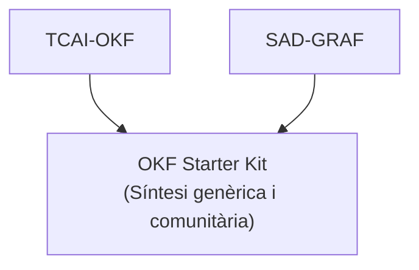

# Filosofia d'OKF

> *«No habitem en carpetes burocràtiques; habitem en xarxes de significat.»*

Aquest document explica el per què d'OKF abans del com. Si només vols posar-te a treballar, salta a [`04-inici-rapid.md`](04-inici-rapid.md). Però si t'interessa entendre d'on surt cada decisió, aquí hi ha la història completa, explicada en primera persona i sense maquillatge.

---

## 1 · La programació didàctica és un organisme viu, no un fòssil administratiu

Soc biòleg de formació i vaig néixer el 1974. Abans de ser docent vaig treballar a la indústria farmacèutica, en control microbiològic. Era un món de protocols estrictes, on el rigor i la traçabilitat no eren una opció: si una cosa no estava escrita, validada i es podia reconstruir pas a pas, no existia. Aquell hàbit no se'n va mai.

El 2015, sent interí, em va tocar el «marró» del mòdul de Codificació Sanitària, el que ningú volia per la seva complexitat. Me'l vaig agafar com un repte. Treballant amb ontologies i classificacions mèdiques com SNOMED-CT i la CIM-10 vaig veure una cosa que no he pogut deixar de veure des de llavors: cap concepte viu sol. Cada terme penja d'un altre, hereta d'un tercer i s'especialitza en un quart.

I llavors em va caure la fitxa: **el currículum educatiu funciona d'una manera molt semblant.** No és una llista lineal de Word. És una xarxa viva de conceptes (activitats, criteris d'avaluació, rúbriques) que es relacionen entre ells. És una analogia i no una identitat, però és prou bona per canviar la manera de treballar.

Per això convé distingir dues coses que sovint es barregen:

| | Què és | Com és |
|---|---|---|
| **Currículum oficial** | El decret | Fixat per l'administració. El canvia qui té la competència per fer-ho, no pas nosaltres, i el respectem tal com és. |
| **Programació didàctica d'aula** | El que en fem a l'aula | Un organisme viu: canvia cada curs, cada grup, cada setembre. |

**El graf de Markdown és la programació viva.** El document que lliurem a Inspecció és una *fotografia*, una vista derivada que generem quan toca complir el tràmit i que revisem abans de lliurar-la, perquè el que arriba a l'administració ha de ser fidel al que fem de debò. La feina real viu al graf; el paper n'és el reflex.

---

## 2 · Sobirania: el coneixement és teu i camina a la teva motxilla

Massa vegades la feina d'un docent queda atrapada en plataformes privatives. Hi passes cursos construint materials, i el dia que canvies de centre, o que la plataforma canvia de condicions, descobreixes que no ets propietari de res. Anys de criteri professional tancats darrere d'un compte que no controles.

OKF defensa tres pilars:

1. **El coneixement professional al teu propi equip.** L'estructura, el criteri i els materials que has treballat són en fitxers que tens tu, no en el núvol de ningú.
2. **El text pla.** Cap format és etern, però el text pla és el que millor resisteix el pas del temps i els canvis de programari. Markdown es pot llegir amb qualsevol editor.
3. **El professional abans que la institució.** Et beneficies tu primer. I de retruc, se'n beneficia el centre: quan marxes, el traspàs és net, perquè el teu coneixement és ordenat i portable per naturalesa. Parlo del coneixement professional (criteri, estructura, manera de treballar) i no dels documents oficials del centre, que segueixen les seves pròpies regles.

Aquesta sobirania és del **coneixement**, no dels models. Treballem amb models de llenguatge que no controlem. El que sí controlem és que el que hem construït estigui en un format que es pot dur a un altre model, o a cap.

---

## 3 · El factor Montse i el Taller d'Artesania (MIAE + VCER)

L'agost de 2026 vaig muntar el graf del cicle TCAI i vaig començar a operar-lo amb IA, amb bateries de *prompts* cada vegada més elaborats. Els passava a la Montse G., la meva co-docent del torn de tarda. I ella s'atabalava.

Era perfectament normal. El meu sistema fallava, i fallava per culpa meva: havia donat per fet que els companys havien de tenir el meu perfil tecno-friqui. No és així, ni té per què ser-ho.

D'aquí va néixer el **Paquet LLM**, pensat per cuidar la Montse. Vaig encapsular les instruccions en una recepta oberta, transparent i en text pla. Ella la pot llegir, entendre què li demanem a la IA a cada pas i adaptar-la: si una línia no li serveix, la retalla; si en falta una, l'afegeix. Ella és la veritable usuària del sistema, i de moment anem harmonitzats matí i tarda sense angoixa tecnològica.

El taller, a més, no treballa amb qualsevol eina. Hi ha dos marcs ètics que ens guien:

- **MIAE (Nivell 3).** Estableix que la supervisió humana no és opcional: l'esborrany que genera la IA és això, un esborrany, i el docent és qui el revisa i el signa.
- **VCER** (*Vibe Coding Educatiu Responsable*). Aposta per artefactes d'aula 100% offline, privats i lliures. Parlo dels materials que en resulten: allò que arriba a l'aula funciona sense dependre de cap servei extern.

I una norma de sentit comú que ens posem: **dades personals de l'alumnat, ni al graf ni als *prompts*.** El graf guarda l'estructura i els models de treball, mai persones.

---

## 4 · Una proposta de sistema operatiu: l'ordre que fa lliure la ment

OKF no és un programa que s'instal·la. És una **capa d'abstracció**: una manera d'organitzar el coneixement sobre la qual altres coses es poden construir, de la mateixa manera que el web va esdevenir una capa sobre la qual es va construir tota la resta, tal com va plantejar Tim O'Reilly.

Si fem servir la metàfora d'un sistema operatiu, el paral·lelisme és aquest:

| Sistema operatiu | OKF |
|---|---|
| Kernel | **Cores** |
| API | **YAML + Validador** |
| Drivers | **Plantilles** |
| Aplicacions | **Paquets LLM** |

Els Cores són el nucli estable (els detalls, a [`03-arquitectura.md`](03-arquitectura.md)). El YAML i el validador defineixen el contracte que fa que els nodes encaixin. Les plantilles adapten el sistema a cada tipus de contingut. I els Paquets LLM són les aplicacions que el docent fa servir al dia a dia.

Com qualsevol metàfora, aquesta té un límit: un sistema operatiu fa complir les regles, i OKF només les proposa i, com a molt, les comprova.

---

## 5 · Transparència on es pot, verificació on no

Seria fàcil escriure aquí que OKF no té cap caixa negra. No seria cert, i seria poc honest. Un model de llenguatge és opac per naturalesa: no podem veure per què genera una resposta i no una altra, i amb la mateixa instrucció pot respondre diferent demà.

Per això cal separar dues coses.

**El que és transparent, i ho és de debò, és tot el que hi posem nosaltres:**

- Els Paquets LLM són receptes obertes, transparents i en text pla. El docent les llegeix, les entén i les modifica retallant o afegint una línia.
- Els nodes del graf són text pla.
- El validador és un script de Python d'unes 400 línies que qualsevol persona amb curiositat pot llegir.

**El que no és transparent és el model que executa la recepta, i d'això ens protegim, no ho dissimulem.** Vinc del control microbiològic, i allà tampoc no obries la incubadora per saber si funcionava: la qualificaves, hi posaves controls i ho registraves tot. Aplico el mateix criteri:

1. **Instruccions explícites i versionables.** Si el resultat canvia, pots comparar què li havies demanat.
2. **Validació de l'estructura.** Quan el resultat no compleix la forma que toca, el validador t'assenyala **on** és l'error i **per què**, no et diu simplement «alguna cosa ha fallat».
3. **Supervisió humana (MIAE).** L'última paraula és sempre d'una persona que coneix la matèria.

I cal dir també què no pot fer el validador: **comprova la forma, no la veritat.** Un codi CIE-10 pot tenir un format perfecte i no existir. Aquesta darrera verificació només la pot fer algú que domina l'àmbit, i per això el docent no és prescindible.

La transparència d'OKF és la de la recepta i la de l'ofici. La del model no la tenim, i el que fem és no fer veure que sí.

---

## 6 · La solidaritat del gremi i l'antídot a la sobreenginyeria

OKF no es prova en un laboratori; es prova amb companys reals, entre hores o sopant, i amb calma. No és una mostra estadística ni pretén ser-ho: són proves artesanals que ens diuen on grinyola.

- **Benet M.**, un amic novell a la docència. Li vaig muntar un mòdul sencer de Química, una matèria que jo no domino, per veure si l'estructura aguantava fora de la meva zona de confort.
- **Anna C.**, mestra d'educació especial. Mirem amb ella com el graf pot ajudar a estructurar Plans Individuals i adaptacions (el model de treball, no les dades de l'alumnat).
- **César G.**, company de Sanitat.

I ara, la confessió clau: **els meus propis vaults de TCAI i SAD pateixen de sobreenginyeria.** Em vaig obsessionar. Quan tens la tendència de voler millorar contínuament, arriba un moment en què el sistema pesa més que la feina que hauria d'alleugerir.

L'**OKF Starter Kit** neix justament d'aquesta autocrítica. És una operació de neteja: ho he reduït tot a l'os, a la mínima expressió que aguanta el sistema, perquè sigui compartible. El que no hi ha, ho afegirà cada docent a mida.

Allibero el codi amb **doble llicència (MIT / CC BY-SA 4.0)** per avançar conjuntament, fer sinergies i crear tribu. La lentitud del prova-error individual és un luxe que no ens podem permetre: cada docent que redescobreix pel seu compte el que un altre ja ha descobert perd un temps que no li sobra, i el coneixement acaba perdut cada setembre.

---

## 7 · Els orígens del sistema (Genealogia)

L'OKF Starter Kit no ha nascut de zero. És la síntesi de dos projectes reals, treballats a l'aula:

- **TCAI-OKF** és el graf del cicle TCAI. És on va néixer el Paquet LLM i on vaig aprendre el factor Montse.
- **SAD-GRAF** és l'altre graf d'origen. Com el de TCAI, va acabar patint de sobreenginyeria.

De la fricció entre tots dos en va sortir el que realment importa: un esquelet mínim, genèric i obert.

---

## Resum: els sis principis

| # | Principi | En una frase |
|---|---|---|
| 1 | **Programació viva** | El graf és l'organisme; el document d'Inspecció és una fotografia que es revisa abans de lliurar-la. |
| 2 | **Sobirania** | El coneixement és teu, viu a casa teva i en text pla; els models són intercanviables. |
| 3 | **Taller responsable** | MIAE (supervisió humana) i VCER (materials offline, privats i lliures). |
| 4 | **Sistema operatiu** | Una capa d'abstracció, no un programa: Cores, validador, plantilles i Paquets LLM. |
| 5 | **Transparència i verificació** | Receptes, graf i validador són llegibles; el model no ho és, i per això validem i supervisem. |
| 6 | **Solidaritat** | Prova amb companys reals, neteja de sobreenginyeria i llicència oberta. |

---

## Següents passos

- [`01-que-es-okf.md`](01-que-es-okf.md): una visió general de què és OKF.
- [`03-arquitectura.md`](03-arquitectura.md): com està organitzat el sistema per dins.
- [`04-inici-rapid.md`](04-inici-rapid.md): posa't a treballar en deu minuts.
