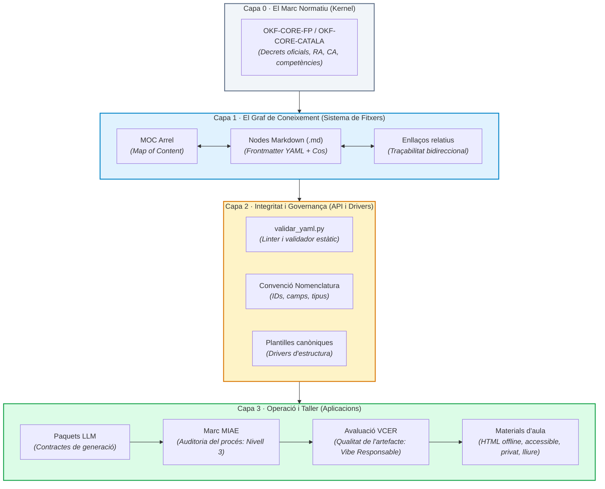
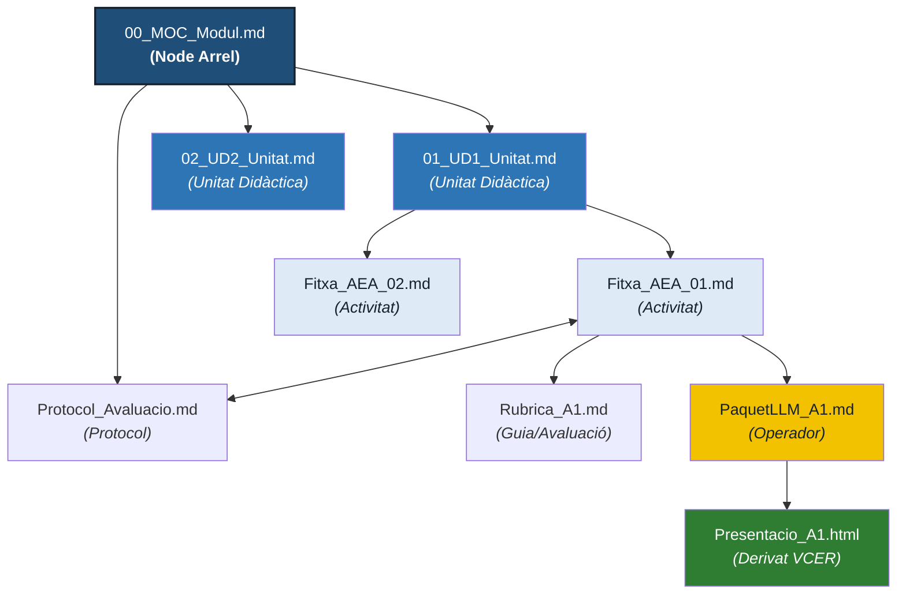

# Arquitectura del Sistema OKF

> **Especificació tècnica de l'arquitectura d'informació, el model de capes, la topologia del graf, el motor de validació i el desplegament d'operacions (MIAE + VCER) d'OKF Starter Kit.**

Aquest document descriu l'enginyeria interna del sistema. Està pensat per a docents que vulguin aprofundir en el funcionament del kit, coordinadors pedagògics o tecnològics, i qualsevol persona que vulgui auditar, ampliar o adaptar el codi, les regles de validació i les plantilles canòniques.

---

## 1 · El model de 4 capes

Perquè el coneixement curricular sigui sobirà, auditable i operable, OKF no s'estructura com un calaix d'arxius, sinó com un **sistema operatiu de coneixement**. Aquest sistema s'articula en quatre capes d'abstracció ben delimitades:



### Descripció de les capes:

* **Capa 0 · Marc Normatiu (Kernel):** Els decrets oficials (DOGC / BOE) plasmats en els `01-cores/`. Són les regles universals del cicle o etapa (Resultats d'Aprenentatge, Criteris d'Avaluació, competències clau).
* **Capa 1 · El Graf de Coneixement (Sistema de fitxers):** La teva programació didàctica viva. Fitxers de text pla (`.md`) interconnectats mitjançant rutes relatives estàndard. És la font de veritat absoluta del curs.
* **Capa 2 · Integritat i Governança (API i Drivers):** El validador en Python (`validar_yaml.py`), les plantilles i les regles de nomenclatura. Garanteixen que cap node s'incorpori al vault amb dades corruptes, enllaços trencats o camps obligatoris absents.
* **Capa 3 · Operació i Taller (Aplicacions):** Els Paquets LLM i els generadors d'aula. Transformen el graf en presentacions HTML interactives, fitxes editables o quaderns de seguiment sota el doble control de **MIAE** (supervisió del procés) i **VCER** (qualitat i ètica del producte).

---

## 2 · Topologia del Graf: Com es connecta el curs

A OKF la jerarquia no ve imposada per carpetes rígides que aïllen documents, sinó per **connexions semàntiques**. El graf es desplega en arbre i xarxa alhora:



### Regles de topologia:
1. **El MOC (Map of Content) és la porta d'entrada:** Tot vault té un node MOC arrel que indexa i governa el mòdul.
2. **Enllaços relatius purs:** Totes les connexions es fan amb sintaxi Markdown estàndard: `[Activitat 1](./02_Fitxa_AEA_1.md)`. Mai s'utilitzen rutes absolutes (`/Users/...`) ni protocols privatius. El vault es pot moure d'ordinador, clonar per git o obrir en qualsevol sistema operatiu sense trencar vincles.
3. **Traçabilitat bidireccional:** Des del MOC pots baixar fins a la fitxa d'una activitat concreta; des de la fitxa de l'activitat pots remuntar fins al Resultat d'Aprenentatge (RA) oficial que desenvolupa i enllaçar amb el protocol d'avaluació global.

---

## 3 · Anatomia d'un Node OKF

Cada fitxer del sistema té una estructura dual estricta: **metadades per a les màquines al principi, llenguatge natural per a les persones a continuació**.

```markdown
---
# ========================================================
# 1. METADADES DE FRAMEWORK (Capa de sistema · En anglès)
# ========================================================
id: SAN-MP1519-UD-01
type: UnitatDidactica
title: "Unitat 1: Gestió de mostres biològiques"
subtitle: "Procediments de recollida, transport i conservació"
version: "V1.0"
academic_year: "2026-2027"
legal_framework: "LOE"
cycle: "CFGS Documentació i Administració Sanitàries"
authors:
  - "Docent de Sanitat"
tags:
  - okf/ud
  - mp1519/mostres

# ========================================================
# 2. METADADES DE DOMINI (Capa curricular · En català)
# ========================================================
data_ultima_actualitzacio: "2026-10-28"
estat: "vigent"
credit: "MP1519"
durada: "25 h"
resultats_aprenentatge:
  - "RA1"
criteris_avaluacio:
  - "1a"
  - "1b"
  - "1d"
---

# Unitat 1: Gestió de mostres biològiques

El cos del document conté el desplegament didàctic en Markdown net:
introducció, connexions curriculars, llistat d'activitats i avaluació.

## Activitats d'aprenentatge associades
- [Fitxa AEA 01: Recepció i registre de mostres](../02-exemple-complet/03_MP1519_Fitxa_AEA_1.md)
```

---

## 4 · La Convenció YAML Mixta (EN / CA)

Una decisió clau d'enginyeria d'OKF és la **convenció de nomenclatura mixta** per als camps del frontmatter. No és un descuit ni una improvisació; respon a la separació nítida entre **sistema** i **pedagogia**:

| Àmbit | Idioma | Camps d'exemple | Justificació tècnica |
|:---|:---:|:---|:---|
| **Framework i Identitat** | 🇬🇧 EN | `id`, `type`, `title`, `version`, `authors`, `academic_year`, `legal_framework`, `tags`, `cycle` | Camps universals i interoperables, alineats amb estàndards internacionals de metadades (Dublin Core, GitHub, agents LLM). |
| **Domini Pedagògic** | 🇨🇦 CA | `data_ultima_actualitzacio`, `estat`, `visibilitat`, `credit`, `durada`, `resultats_aprenentatge`, `criteris_avaluacio` | Llenguatge natural de la comunitat docent catalana. Traduir `resultats_aprenentatge` a `learning_outcomes` crearia una barrera artificial per al professorat. |

### Criteri per incorporar camps nous:
* Si el camp defineix **el fitxer com a objecte informàtic** (qui l'ha fet, quina llicència té, com es versiona) $\rightarrow$ **Anglès** (`snake_case`).
* Si el camp defineix **la pràctica educativa d'aula** (hores, agrupaments, ponderacions, criteris) $\rightarrow$ **Català** sense accents (`snake_case`).

---

## 5 · Identificadors canònics (Format d'`id`)

Cada node té una clau primària única (`id`) que permet indexar-lo de manera inequívoca:

$$\mathbf{\{CODI\}-\{ÀMBIT\}-\{NN\}}$$

| Segment | Significat | Exemples |
|:---|:---|:---|
| **`CODI`** | Identificador del mòdul, cicle o marc | `MP1519`, `QU20`, `TCAI`, `OKF` |
| **`ÀMBIT`** | Tipus documental o unitat funcional | `MOC`, `UD1`, `AEA`, `PROT`, `LLM` |
| **`NN`** | Seqüencial de dues xifres | `00` (arrels/generals), `01`, `02`... |

*Exemples canònics:* `MP1519-MOC-00`, `QU20-MP1257-UD-01`, `SAN-AEA-03`.

---

## 6 · Catàleg canònic de tipus de node

El Starter Kit admet **15 tipus de node** organitzats segons el seu nivell de dependència curricular:

### 6.1 · Nodes Curriculars (Requereixen el camp `credit`)
Tenen un impacte directe en la qualificació i en el seguiment acadèmic:
* **`UnitatDidactica`:** El disseny global d'un bloc temàtic o situació d'aprenentatge.
* **`FitxaAEA`:** Fitxa d'Activitat d'Ensenyament-Aprenentatge (la seqüència d'aula detallada).
* **`PaquetLLM`:** Operador que conté el contracte de prompts per generar materials derivats.

### 6.2 · Nodes Transversals i de Governança (Sense requeriment de `credit`)
Estructuren i protegeixen el funcionament del vault:
* **Estructura i Navegació:** `MOC`, `CatalegCurricular`, `CoordinacioCurricular`.
* **Regulació i Procediment:** `ConvencioNomenclatura`, `Protocol`, `Guia`, `Glossari`.
* **Qualitat i Gestió del Canvi:** `DocumentHandoff`, `NotaDecisions`, `PlaEstrategic`, `EinaTecnica`, `Estàndard`.

---

## 7 · El Validador estàtic (`validar_yaml.py`)

El validador és el cor de la Capa 2. És un script en Python 3 de 400 línies, sense dependències externes feixugues (només requereix `pyyaml`), dissenyat per ser auditat per qualsevol persona.

```
       ┌───────────────────────────────┐
       │   Execució del Validador     │
       │   python3 validar_yaml.py     │
       └──────────────┬────────────────┘
                      │
        ┌─────────────┴─────────────┐
        ▼                           ▼
┌──────────────┐            ┌──────────────┐
│  Parsing     │            │  Comprovació │
│  YAML        │            │  de Regles   │
└───────┬──────┘            └──────┬───────┘
        │                          │
        └─────────────┬────────────┘
                      ▼
        ┌───────────────────────────┐
        │  Generació d'Informe      │
        │  • 🔴 Errors crítics      │
        │  • 🟠 Errors estructurals │
        │  • 🟡 Advertències        │
        └───────────────────────────┘
```

### Matriu de Codis d'Error:

| Codi | Gravetat | Descripció de la fallada | Acció correctora |
|:---:|:---:|:---|:---|
| **Y001** | 🔴 Crític | YAML inexistent, mal tancat o sintàctiament invàlid | Revisar la sintaxi de guions i espais |
| **Y002** | 🔴 Crític | Manca un camp obligatori del framework | Afegir el camp requerit a la capçalera |
| **Y003** | 🔴 Crític | Node de crèdit (`UnitatDidactica`, `FitxaAEA`...) sense camp `credit` | Indicar el codi de mòdul corresponent |
| **Y004** | 🔴 Crític | El camp `type` no és cap dels 15 tipus permesos | Assignar un tipus canònic de la Convenció |
| **Y005** | 🟠 Alt | L'`id` no respecta el patró `{CODI}-{ÀMBIT}-{NN}` | Normalitzar el format de l'identificador |
| **Y006** | 🔴 Crític | S'ha detectat un `id` duplicat en un altre fitxer | Assignar un identificador únic al node |
| **Y007** | 🟡 Avís | Les etiquetes no comencen amb el prefix `okf/` | Afegir el prefix de control semàntic |
| **Y008** | 🟡 Avís | La data no segueix el format estàndard ISO 8601 (`YYYY-MM-DD`) | Corregir la data de modificació |
| **Y009** | 🟡 Avís | La versió no segueix el patró `V<major>.<minor>` | Fixar la versió (ex: `V1.0`) |
| **Y012** | 🔴 Crític | Presència de terminologia prohibida segons el marc | Depurar termes incompatibles |
| **Y013** | 🔴 Crític | Incoherència amb el marc legal declarat (`legal_framework`) | Adequar el marc (LOE / LOMLOE) |

El validador s'executa localment i retorna codis de sortida estàndard per a pipelines d'integració contínua (`0` = net, `1` = errors de validació, `2` = fallada d'execució).

---

## 8 · La Capa d'Operacions: Paquets LLM, Marc MIAE i Avaluació VCER

L'arquitectura d'OKF resol els dos grans problemes de la Intel·ligència Artificial a l'educació: **el risc d'al·lucinació curricular** (contingut descontextualitzat) i **la fragilitat ètica i tècnica dels materials generats** (dependències al núvol, formats privatius o manca d'accessibilitat).

Un **Paquet LLM** no és una llista de *prompts* desordenats. És un document estructurat que actua com a **contracte de generació**. Per garantir que el resultat sigui professional, rigorós i segur per a l'alumnat, el sistema articula dos marcs complementaris:

```
┌────────────────────────────────────────────────────────────────────────┐
│  PAQUET LLM (Contracte) + CONTEXT DEL GRAF                             │
└───────────────────────────────────┬────────────────────────────────────┘
                                    │
                                    ▼
┌────────────────────────────────────────────────────────────────────────┐
│  1. AUDITORIA DEL PROCÉS · Marc MIAE (Nivell 3)                        │
│  Supervisió humana obligatòria: la IA proposa l'esborrany sobre els    │
│  nodes del graf, però el docent reconstrueix, valida i ajusta.         │
└───────────────────────────────────┬────────────────────────────────────┘
                                    │
                                    ▼
┌────────────────────────────────────────────────────────────────────────┐
│  2. AUDITORIA DE L'ARTEFACTE · Rúbrica VCER (Vibe Responsable)         │
│  El material generat ha de superar els criteris de qualitat:           │
│  • Privacitat absoluta: zero recollida de dades de l'alumnat.          │
│  • Autocontingut: fitxers únics, sense dependències ni CDNs externs.   │
│  • Accessibilitat: navegació per teclat, contrast cromàtic i semàntica.│
│  • Sobirania: codi net, editable amb qualsevol eina i llicència lliure.│
└───────────────────────────────────┬────────────────────────────────────┘
                                    │
                                    ▼
┌────────────────────────────────────────────────────────────────────────┐
│  MATERIAL D'AULA LLEST (HTML projectable, fitxa Word, prova summativa) │
└────────────────────────────────────────────────────────────────────────┘
```

### 8.1 · Marc MIAE: El control del procés (Qui fa què)
Declara el grau d'intervenció humana en la creació del recurs (Marc per a la integració de la IA generativa en les tasques educatives). A OKF el valor canònic és el **Nivell 3** (*esborrany generat per IA + reconstrucció humana*):
* La IA no té permís per decidir continguts de seguretat ni ponderacions d'avaluació de manera autònoma.
* El docent audita sempre el resultat abans de portar-lo a l'aula.

### 8.2 · Avaluació VCER: El control de l'artefacte (Com és el recurs)
Inspirat en els principis del [Vibe Coding Educatiu Responsable (VCER)](https://vibe-coding-educativo.github.io/vibe-responsable/ca/), els Paquets LLM d'OKF estan programats amb restriccions d'enginyeria perquè qualsevol material generat superi amb la màxima qualificació la rúbrica VCER:
1. **Seguretat i privacitat de l'alumnat:** Les aplicacions i presentacions generades funcionen en local; mai demanen registre, ni galetes, ni envien telemetria a servidors de tercers.
2. **Accessibilitat universal:** Les presentacions HTML integren navegació completa per teclat (`←`, `→`, `Espai`, mode de notes per al ponent amb `N`, pantalla completa amb `F`), escalat fluid per a qualsevol projector i contrastos validats.
3. **Resiliència i durabilitat (Zero dependències):** Cap presentació o fitxa generada depèn de llibreries remotes (com Bootstrap o fonts externes). Si a l'institut cau la connexió a internet, la teva classe funciona al 100%.
4. **Transparència i llicència oberta:** Els materials declaren clarament la seva autoria, com han estat construïts i s'alliberen sota llicència lliure (Creative Commons o MIT) perquè altres docents els puguin reutilitzar.

---

## 9 · Cicle de Vida i Governança del Coneixement

Un node d'OKF no és un arxiu estàtic; té un cicle de vida auditable a través de Git:

```
[Redacció del node]
       │
       ▼
[Validació local (validar_yaml.py)] ──(Hi ha errors)──► [Correcció de sintaxi/camps]
       │ (0 errors)
       ▼
[Enllaçament al MOC / Nodes pares]
       │
       ▼
[Operació de materials (Paquet LLM: MIAE 3 + VCER)]
       │
       ▼
[Commit i versionatge semàntic a Git]
```

* **Estats canònics (`estat`):** `esborrany` (en construcció) $\rightarrow$ `vigent` (aprovat i en ús a l'aula) $\rightarrow$ `obsolescit` / `arxivat` (reemplaçat per una nova versió curricular).
* **Control de versions:** Tota modificació pedagògica substancial implica un increment de versió al frontmatter (`V1.0` $\rightarrow$ `V1.1`) i un registre a la taula de versionatge al final del node.

---

## 10 · Resum de l'Arquitectura

| Aspecte | Decisió d'Arquitectura | Benefici per al docent |
|:---|:---|:---|
| **Emmagatzematge** | Text pla (Markdown + YAML) | Sobirania total, sense obsolescència ni dependència de servidors. |
| **Connexió** | Graf de nodes amb enllaços relatius | Traçabilitat curricular completa: RA $\rightarrow$ CA $\rightarrow$ AEA $\rightarrow$ Rúbrica. |
| **Integritat** | Validador estàtic en Python (`Y001-Y013`) | Pau mental: zero enllaços trencats o programacions incoherents. |
| **Procés IA** | Marc MIAE (Nivell 3) | Supervisió humana garantida en avaluació i seguretat. |
| **Producte IA** | Avaluació VCER | Materials accessibles, privats, 100% offline i duradors. |
| **Nomenclatura** | Convenció mixta (EN Framework / CA Domini) | Interoperabilitat tècnica internacional i claredat docent local. |

---

## Relacions

- [Què és OKF](./01-que-es-okf.md) — Introducció conceptual i el valor del graf
- [Filosofia](./02-filosofia.md) — Els fonaments ètics i la mirada biològica/ontològica
- [Inici ràpid](./04-inici-rapid.md) — Tutorial pràctic per crear el teu primer node
- [Guia VCER](https://vibe-coding-educativo.github.io/vibe-responsable/ca/) — Marc de Vibe Coding Educatiu Responsable
```