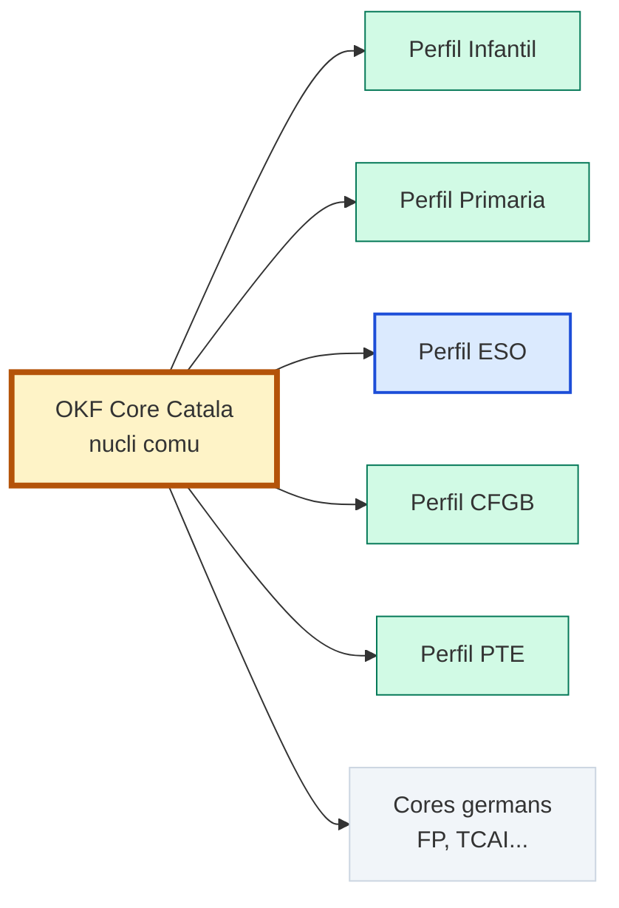

# OKF Core Català

> **Propòsit.** Fixar el **nucli comú** que han de compartir tots els vaults OKF de l'educació bàsica a Catalunya (infantil, primària, ESO i Cicles Formatius de Grau Bàsic), per tal que siguin **coherents, compatibles i interoperables** entre si.

> **Abast.** Aquest document és la **font de veritat del nucli**. No conté tipus ni camps de cap etapa concreta: això correspon als **perfils de família** (infantil, primària, ESO, CFGB, PTE, etc.).

> **Relació amb altres convencions.** Els perfils de família hereten aquest core i només hi afegeixen el que és propi del seu domini. Les convencions de SAD, TCAI, FP i PTE han de convergir cap a aquest nucli o declarar-se **cores germans** si el marc legal és diferent.



---

## 1 · Marc legal de referència

### 1.1 · Normativa vigent
Aquest core s'emmarca en:
- **LOMLOE** (Llei orgànica 3/2020, de 29 de desembre).
- **Decret 175/2022**, de 27 de setembre, d'ordenació dels ensenyaments de l'educació bàsica a Catalunya.
- **Decret 480/2024**, de 17 de desembre, de modificació del Decret 175/2022 (actualitza horaris, competències, matèries i aspectes d'avaluació).
- **Reial decret 157/2022** (ensenyaments mínims d'educació primària).
- **Reial decret 217/2022** (ensenyaments mínims d'educació secundària obligatòria).

### 1.2 · Estructura d'etapes i cicles
El core reconeix l'estructura oficial de l'educació bàsica a Catalunya:
- **Educació Primària:** 3 cicles (1r-2n, 3r-4t, 5è-6è).
- **Educació Secundària Obligatòria (ESO):** 2 cicles (1r-3r, 4t).
- **Cicles Formatius de Grau Bàsic (CFGB):** Formen part de l'educació bàsica i s'organitzen en dos cursos (1r i 2n), amb una escolarització que pot arribar fins als 21 anys en casos específics.

El currículum s'organitza al voltant de:
- **Competències clau** i **perfil competencial de sortida**.
- **Competències específiques** de cada àrea, matèria o àmbit.
- **Criteris d'avaluació**.
- **Sabers**.
- **Situacions d'aprenentatge**.

Aquest core **no fixa** aquests elements curriculars: fixa la **forma** dels nodes que els descriuen.

---

## 2 · 9 tipus universals

Aquests 9 tipus són **tancats i compartits** per tots els vaults OKF de l'educació bàsica catalana. No es redefineixen mai en un perfil de família.

| # | `type` | Descripció breu |
|:-:|:---|:---|
| 1 | `MOC` | Map of Content. Índex navegable d'un àmbit, etapa o matèria. |
| 2 | `Guia` | Material formatiu: conceptes, explicacions, orientacions. |
| 3 | `Glossari` | Recull terminològic amb definicions acordades. |
| 4 | `Protocol` | Regles operatives o de governança. |
| 5 | `PaquetLLM` | Document autocontingut per generar material amb un LLM. |
| 6 | `ConvencioNomenclatura` | Regles formals del vault (aquest document n'és un). |
| 7 | `Llicencia` | Documents legals i de llicència. |
| 8 | `Plantilla` | Plantilles de treball per als usuaris. |
| 9 | `DocumentHandoff` | Transferència de context entre sessions o agents. |

**Nota sobre `Test`.** `Test` **no és universal**. És un tipus de família que cada perfil pot declarar si el necessita (per exemple, ESO o primària per a qüestionaris d'autoavaluació). Això resol el conflicte actual entre ESO (que el té com a universal) i SAD/PTE (que tenen `DocumentHandoff`).

---

## 3 · 8 camps universals obligatoris

Tots els nodes de tots els vaults OKF de l'educació bàsica catalana han de tenir aquests 8 camps al frontmatter YAML. Són el **mínim comú** que garanteix la interoperabilitat.

| Camp | Tipus | Descripció |
|:---|:---|:---|
| `id` | string | Identificador únic del node. Vegeu §5.1. |
| `type` | string | Un dels 9 tipus universals de §2 (o un tipus de família declarat al perfil). |
| `title` | string | Títol llegible del node. |
| `version` | string | Versió del node (`V1.0`, `V1.1-Esborrany`, etc.). |
| `data_ultima_actualitzacio` | string (ISO 8601) | Data de la darrera modificació. |
| `authors` | array de strings | Autors del node. |
| `llicencia` | string | Llicència del contingut (recomanat: `CC BY-SA 4.0`). |
| `tags` | array de strings | Etiquetes de navegació. |

> **Regla d'or:** cap perfil de família no pot **treure** aquests 8 camps ni canviar-ne el significat. Només pot **afegir** camps de família.

---

## 4 · Enums comuns

### 4.1 · `visibilitat`

Camp **universal opcional** (si no es declara, s'assumeix `interna`). L'enum és **tancat** i compartit per tots els vaults.

| Valor | Significat | Ús típic |
|:---|:---|:---|
| `publica` | Consultable per qualsevol. | Materials d'aula, guies didàctiques. |
| `interna` | Consultable dins del centre, sense difusió externa. | Documentació de sistema, programacions. |
| `restringida` | Només per al mantenidor i col·laboradors directes. | Protocols sensibles, dades de menors. |
| `personal` | Només per a l'autor. | Notes privades, esborranys íntims. |
| `externa` | Pensat per a difusió fora del centre. | Whitepapers, articles, publicacions. |

**Regla de privacitat:** cap node amb dades de menors pot ser `publica`. Els PI i informes individuals han de ser com a mínim `restringida`. Aquesta regla és **heretada del perfil PTE** i s'aplica a tots els perfils que tractin dades de menors.

> **Alineació:** `restricted` (PTE) s'ha de mapar a `restringida`. `restringida` és el valor canònic del core.

### 4.2 · `estat`

Camp **universal opcional** (si no es declara, s'assumeix `vigent`). L'enum és **tancat**.

| Valor | Significat |
|:---|:---|
| `vigent` | Node actualment vàlid i en ús. |
| `esborrany` | Node en construcció, no validat. |
| `obsolet` | Node substituït per una versió més nova. |
| `arxivat` | Node conservat per historial, fora d'ús actiu. |

Cada perfil pot fer `estat` **obligatori** si vol, però el core el deixa **opcional** per no trencar vaults existents que no el tenen (ESO, PTE).

### 4.3 · Competències transversals (Annex 4)
D'acord amb l'article 24.9 i l'Annex 4 del Decret 175/2022, l'avaluació de final d'etapa requereix registrar el grau d'assoliment de les **4 competències transversals**. Aquestes no substitueixen les 8 competències clau de l'Annex 1, sinó que les complementen.
Qualsevol node que avaluï competències (per exemple, un `InformeAvaluacio` o un `Test`) hauria de preveure camps o taules per a:
- Competència ciutadana
- Competència emprenedora
- Competència personal, social i d'aprendre a aprendre
- Competència digital

---

## 5 · Regles de nomenclatura

### 5.1 · Format del camp `id`

```
{CODI}-{ÀMBIT}-{NN}
```

| Component | Descripció |
|:---|:---|
| `CODI` | Prefix del vault o del domini (màxim 8 caràcters, majúscules). |
| `ÀMBIT` | Domini o subsistema (3-12 caràcters, majúscules). |
| `NN` | Número seqüencial de dues xifres (`00`, `01`, `02`, ...). |

**Exemples vàlids:**
- `ESO-MOC-00`
- `ESO-M2-L02`
- `PTE-CONV-00`
- `SAD-MP1520-MOC-00`
- `TCAI-CONVENCIO-NOMENCLATURA-00`

**Nota:** els identificadors amb més de dues xifres o amb sufixos lletres (`L01`) són acceptables si el perfil ho documenta, però el core **recomana** el patró `NN` de dues xifres per facilitar la validació automàtica.

### 5.2 · Nom del fitxer

El nom del fitxer `.md` ha de ser **estable i únic** dins del vault. El core **no imposa** una correspondència exacta amb l'`id`, però recomana una d'aquestes dues estratègies:
1. **Correspondència directa:** `id: ESO-MOC-00` → `ESO-MOC-00.md`.
2. **Nom descriptiu prefixat:** `id: ESO-MOC-00` → `00_ESO_MOC.md`.

El que **no es pot fer** és tenir dos fitxers amb el mateix `id` o un `id` sense fitxer associat.

### 5.3 · Caràcters permesos als noms de fitxer
- Lletres sense accents (`a-z`, `A-Z`).
- Dígits (`0-9`).
- Guió baix (`_`) i guió (`-`).
- Extensió `.md`.

**Prohibit:** accents, `ç`, `ñ`, espais, caràcters especials.

---

## 6 · Sintaxi d'enllaç i metodologia

### 6.1 · Sintaxi d'enllaç
El core fixa **una única sintaxi d'enllaç intern** per garantir la interoperabilitat:

```markdown
[text visible](../ruta/relativa/al/fitxer.md)
```

**Regles:**
1. **Sempre ruta relativa** des del fitxer origen.
2. **Sempre extensió `.md`** inclosa.
3. **Sempre text visible** (no enllaços buits).
4. **Prohibit wiki links** (`[[...]]`) al core. Si un vault els usa (SAD), ha de declarar un **conversor documentat** o migrar a Markdown relativament.

**Exemples:**
```markdown
[Convenció del curs](../ESO-CONVENCIO-00.md)
[MOC del MP 1520](../MP1520_Codificacio_Sanitaria/00_MP1520_MOC.md)
[Glossari](./03_Glossari.md)
```

### 6.2 · Aprenentatge basat en situacions (Annex 5)
El core incentiva l'ús dels nodes de tipus `UnitatDidactica`, `SequenciaDidactica` o similars per vehicular l'**aprenentatge basat en situacions**. Les situacions d'aprenentatge (contextos reals, reptes, problemes) han de ser el marc on es desenvolupin les competències específiques i on es produeixi la síntesi dels sabers.

---

## 7 · Declaració d'interoperabilitat

Un vault OKF de l'educació bàsica catalana és **interoperable amb el core** si compleix aquests 7 punts:

| # | Requisit | Com es comprova |
|:-:|:---|:---|
| 1 | Té un `MOC` arrel | Existeix un node `type: MOC` que indexa el vault. |
| 2 | Té un `ConvencioNomenclatura` | Existeix un node `type: ConvencioNomenclatura` que referencia aquest core. |
| 3 | Té un `DocumentHandoff` | Existeix un node `type: DocumentHandoff` per a la transferència de context. |
| 4 | Tots els nodes tenen els 8 camps universals | Validació automàtica del frontmatter. |
| 5 | Tots els `type` són universals o de família declarats | El perfil de família ha de documentar els seus tipus. |
| 6 | Els enums `visibilitat` i `estat` són els del core | No es poden inventar valors nous al nucli. |
| 7 | Els enllaços interns usen la sintaxi del core | Markdown relatiu amb `.md`. |

Si un vault compleix aquests 7 punts, pot declarar-se **“Interoperable OKF Core Català V1”**.

---

## 8 · Perfils de família

Aquest core **no conté** tipus ni camps d'etapa. Cada perfil de família els declara.

### 8.1 · Perfils previstos

| Perfil | Marc legal | Tipus de família propis (exemples) |
|:---|:---|:---|
| **Infantil** | LOMLOE · Decret 175/2022 | `ProjecteGlobalitzat`, `RacoAprenentatge` |
| **Primària** | LOMLOE · Decret 175/2022 | `SequenciaDidactica`, `ProgramacioArea` |
| **ESO** | LOMLOE · Decret 175/2022 i 480/2024 | `Test`, `ProgramacioMateria`, `ProjecteIntermodular`, `CulturaCientifica` |
| **CFGB** | LOMLOE · Decret 175/2022 | `AmbitConeixement`, `ProjecteProfessional` |
| **PTE** | LOMLOE · Decret 175/2022 | `PlaSuportIndividualitzat`, `AdaptacioCurricular`, `InformeAvaluacio` |

### 8.2 · Camps de família

Els perfils poden afegir camps com:
- `etapa`, `cicle`, `area`, `materia`.
- `dades_personals`, `anonimitzat` (perfil PTE i qualsevol node amb menors).
- `desenvolupa` (per a protocols i paquets LLM).
- `module` (per a SAD, si es declara com a core germà).

**Regla:** un camp de família **no pot** tenir el mateix nom que un camp universal amb un significat diferent.

### 8.3 · Horaris i temporització (Annex 7)

Les hores assignades a cada àrea o matèria es regeixen per l'Annex 7 del Decret 175/2022, modificat pel Decret 480/2024. Els nodes de tipus `Temporitzacio` o `Programacio` han de reflectir la distribució horària vigent. Per exemple, a Primària, les hores de Llengua Catalana i Literatura i de Llengua Castellana i Literatura passen a ser de 588 hores cadascuna, amb una reducció de les hores de gestió autònoma a 819 hores.

---

## 9 · Cores germans

Els vaults amb marc legal diferent **no hereten aquest core**, però en comparteixen els 9 universals i els 8 camps. Es declaren **cores germans**.

| Core germà | Marc legal | Relació |
|:---|:---|:---|
| **OKF Core FP** | LOE · LO 3/2022 | Comparteix els 9 universals i els 8 camps; té família pròpia. |
| **OKF Core TCAI** | LOGSE · Decret 203/1997 | Comparteix els 9 universals i els 8 camps; té família pròpia i terminologia LOGSE. |

---

## 10 · Procediment per ampliar el core

Per afegir un tipus universal o modificar un enum:
1. **Detectar la necessitat** en almenys dos perfils de família.
2. **Documentar el cas** i demostrar que no es pot resoldre amb un tipus de família.
3. **Proposar l'ampliació** incrementant la versió (`V1.0 → V1.1`).
4. **Registrar el canvi** a §12.
5. **Verificar dependències** als perfils i als cores germans.
6. **Segellar** la nova versió i actualitzar la data.

---

## 11 · Checklist de conformitat

Abans de desar un node en un vault OKF de l'educació bàsica catalana:
- [ ] El fitxer té frontmatter YAML vàlid.
- [ ] Té els 8 camps universals de §3.
- [ ] El `type` és un dels 9 universals de §2 o un tipus de família declarat al perfil.
- [ ] El `id` segueix el patró de §5.1.
- [ ] El nom del fitxer és únic i sense accents ni espais.
- [ ] Si té `visibilitat`, el valor és un dels 5 de §4.1.
- [ ] Si té `estat`, el valor és un dels 4 de §4.2.
- [ ] Els enllaços interns usen la sintaxi de §6.1.
- [ ] Si el node conté dades de menors, `visibilitat` no és `publica`.
- [ ] El node enllaça al seu MOC (excepte el MOC arrel).
- [ ] Si el node avalua competències, preveu el registre de les 4 competències transversals de §4.3.

---

## Versionatge

| Versió | Data | Descripció |
|:------:|:----:|:-----------|
| V1.0-Esborrany | 2026-10-24 | Creació inicial del nucli OKF Core Català. 9 tipus universals, 8 camps universals, enums de `visibilitat` i `estat`, sintaxi d'enllaç Markdown relatiu, declaració d'interoperabilitat de 7 punts, perfils de família previstos i cores germans (FP, TCAI). |
| **V1.1-Esborrany** | **2026-10-24** | **Alineació amb el Decret 480/2024 i els annexos del Decret 175/2022:**<br>**1. Marc legal:** afegit el Decret 480/2024.<br>**2. Estructura:** documentada l'estructura de cicles de Primària, ESO i CFGB.<br>**3. Competències:** afegida la referència a les 4 competències transversals (Annex 4) i a l'aprenentatge basat en situacions (Annex 5).<br>**4. Perfils:** afegit el perfil de família per a CFGB.<br>**5. Horaris:** afegida la nota sobre la modificació horària (Annex 7) introduïda pel Decret 480/2024. |
| V1.1.1-Esborrany | 2026-10-25 | Adaptació per al OKF Starter Kit: marca neutralitzada (`center`), referències externes eliminades (només enllaç creuat amb el Core FP), `legal_framework` afegit (abans `ambit`), salt de línia final. |

---

## Relacions (Graf)

- Complementa: [OKF-CORE-FP-00](./OKF-CORE-FP-00.md) — core germà de Formació Professional.
