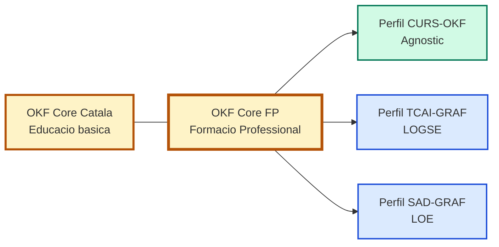

# OKF Core FP

> **Propòsit.** Fixar el **nucli comú** que han de compartir tots els vaults OKF de la Formació Professional (Cicles de Grau Bàsic, Mitjà i Superior), per tal que siguin **coherents, compatibles i interoperables** entre si i amb la resta de l'ecosistema OKF Català.

> **Abast.** Aquest document és la **font de veritat del nucli FP**. No conté tipus ni camps d'un cicle concret: això correspon als **perfils de família** (CURS-OKF, TCAI-GRAF, SAD-GRAF, etc.).

> **Relació amb altres cores.** Aquest core és **germà** de l'[OKF Core Català](./OKF-CORE-CATALA-00.md) (educació bàsica). Comparteixen els 9 tipus universals, els 8 camps universals i els enums. La diferència és el marc legal (FP vs. LOMLOE) i la terminologia.



---

## 1 · Marc legal de referència

### 1.1 · Normativa vigent
Aquest core s'emmarca en:
- **LOE** (Llei Orgànica 2/2006, d'Educació, modificada per la LOMLOE).
- **LO 3/2022**, de 28 de març, d'ordenació i integració de la Formació Professional.
- **RD 659/2023**, de 18 de juliol, pel qual es desenvolupa l'ordenació del Sistema de Formació Professional.

### 1.2 · Origen històric (LOGSE)
El sistema OKF va néixer en un cicle formatiu sota el marc de la **LOGSE** (Llei Orgànica 1/1990) i el Decret 203/1997. Tot i que la majoria de cicles actuals són LOE o LO 3/2022, el core reconeix la LOGSE com a origen i permet que els perfils de família (com el TCAI-GRAF) mantinguin la seva terminologia específica (crèdits, OT, IA).

---

## 2 · 9 tipus universals

Aquests 9 tipus són **tancats i compartits** per tots els vaults OKF de Formació Professional. Són exactament els mateixos que l'OKF Core Català (garantint la interoperabilitat creuada).

| # | `type` | Descripció breu |
|:-:|:---|:---|
| 1 | `MOC` | Map of Content. Índex navegable d'un cicle o mòdul. |
| 2 | `Guia` | Material formatiu: conceptes, explicacions, orientacions. |
| 3 | `Glossari` | Recull terminològic amb definicions acordades. |
| 4 | `Protocol` | Regles operatives o de governança. |
| 5 | `PaquetLLM` | Document autocontingut per generar material amb un LLM. |
| 6 | `ConvencioNomenclatura` | Regles formals del vault (aquest document n'és un). |
| 7 | `Llicencia` | Documents legals i de llicència. |
| 8 | `Plantilla` | Plantilles de treball per als usuaris. |
| 9 | `DocumentHandoff` | Transferència de context entre sessions o agents. |

**Nota sobre `Test`.** Igual que al Core Català, `Test` **no és universal**. És un tipus de família que cada perfil pot declarar (per exemple, per a qüestionaris d'autoavaluació).

---

## 3 · 8 camps universals obligatoris

Tots els nodes de tots els vaults OKF de FP han de tenir aquests 8 camps al frontmatter YAML. Són el **mínim comú** que garanteix la interoperabilitat.

| Camp | Tipus | Descripció |
|:---|:---|:---|
| `id` | string | Identificador únic del node. Vegeu §5.1. |
| `type` | string | Un dels 9 tipus universals de §2 (o un tipus de família declarat al perfil). |
| `title` | string | Títol llegible del node. |
| `version` | string | Versió del node (`V1.0`, `V1.1-Esborrany`, etc.). |
| `data_ultima_actualitzacio` | string (ISO 8601) | Data de la darrera modificació. |
| `authors` | array de strings | Autors del node. |
| `llicencia` | string | Llicència del contingut (recomanat: `CC BY-SA 4.0` o `CC BY-NC-SA 4.0`). |
| `tags` | array de strings | Etiquetes de navegació. |

> **Regla d'or:** cap perfil de família no pot treure aquests 8 camps. Només pot afegir camps de família (ex: `modul`, `credit`, `resultats_aprenentatge`).

---

## 4 · Enums comuns

### 4.1 · `visibilitat`
Camp **universal opcional** (si no es declara, s'assumeix `interna`). L'enum és **tancat** i idèntic al Core Català.

| Valor | Significat | Ús típic |
|:---|:---|:---|
| `publica` | Consultable per qualsevol. | Materials d'aula, guies didàctiques. |
| `interna` | Consultable dins del centre, sense difusió externa. | Documentació de sistema, programacions. |
| `restringida` | Només per al mantenidor i col·laboradors directes. | Protocols sensibles, dades d'alumnes. |
| `personal` | Només per a l'autor. | Notes privades, esborranys íntims. |
| `externa` | Pensat per a difusió fora del centre. | Whitepapers, articles, publicacions. |

**Regla de privacitat:** cap node amb dades personals d'alumnes pot ser `publica`. Els informes individuals han de ser com a mínim `restringida`.

### 4.2 · `estat`
Camp **universal opcional** (si no es declara, s'assumeix `vigent`). L'enum és **tancat**.

| Valor | Significat |
|:---|:---|
| `vigent` | Node actualment vàlid i en ús. |
| `esborrany` | Node en construcció, no validat. |
| `obsolet` | Node substituït per una versió més nova. |
| `arxivat` | Node conservat per historial, fora d'ús actiu. |

---

## 5 · Regles de nomenclatura

### 5.1 · Format del camp `id`

```
{CODI}-{ÀMBIT}-{NN}
```

| Component | Descripció |
|:---|:---|
| `CODI` | Prefix del vault o del domini (màxim 8 caràcters, majúscules). |
| `ÀMBIT` | Domini o subsistema (3-12 caràcters, majúscules). |
| `NN` | Número seqüencial de dues xifres (`00`, `01`, `02`, ...). |

**Exemples vàlids:**
- `CURS-MOC-00` (CURS-OKF)
- `SAD-MP1520-MOC-00` (SAD-GRAF)
- `TCAI-CONVENCIO-00` (TCAI-GRAF)

### 5.2 · Nom del fitxer
El nom del fitxer `.md` ha de ser **estable i únic** dins del vault. Es recomana:
1. Correspondència directa: `id: CURS-MOC-00` → `00_CURS_MOC.md`.
2. Nom descriptiu prefixat.

**Caràcters permesos:** lletres sense accents, dígits, guió baix, guió, extensió `.md`. **Prohibit:** accents, `ç`, espais.

---

## 6 · Sintaxi d'enllaç

El core fixa **una única sintaxi d'enllaç intern**: Markdown relatiu amb extensió `.md`.

```markdown
[text visible](../ruta/relativa/al/fitxer.md)
```

**Regles:** ruta relativa, extensió `.md` inclosa, text visible, prohibit wiki links (`[[...]]`).

---

## 7 · Declaració d'interoperabilitat

Un vault OKF de Formació Professional és **interoperable amb el core** si compleix aquests 7 punts:

| # | Requisit | Com es comprova |
|:-:|:---|:---|
| 1 | Té un `MOC` arrel | Existeix un node `type: MOC` que indexa el vault. |
| 2 | Té un `ConvencioNomenclatura` | Existeix un node que referencia aquest core. |
| 3 | Té un `DocumentHandoff` | Existeix un node `type: DocumentHandoff`. |
| 4 | Tots els nodes tenen els 8 camps universals | Validació automàtica del frontmatter. |
| 5 | Tots els `type` són universals o de família declarats | El perfil ha de documentar els seus tipus. |
| 6 | Els enums `visibilitat` i `estat` són els del core | No es poden inventar valors nous. |
| 7 | Els enllaços interns usen la sintaxi del core | Markdown relatiu amb `.md`. |

Si un vault compleix aquests 7 punts, pot declarar-se **"Interoperable OKF Core FP V1"**.

---

## 8 · Perfils de família i terminologia

Aquest core **no conté** tipus ni camps d'un cicle concret. Cada perfil de família els declara, juntament amb la seva terminologia específica.

### 8.1 · Perfils de família

| Perfil | Marc legal | Terminologia principal |
|:---|:---|:---|
| **CURS-OKF** | Agnòstic (LOE / LOGSE) | Ensenya a construir grafs (no és un cicle). |
| **TCAI-GRAF** | LOGSE (Decret 203/1997) | Crèdit, Objectius Terminals, Indicadors d'Assoliment. |
| **SAD-GRAF** | LOE / LO 3/2022 / RD 659/2023 | Mòdul Professional (MP), Resultats d'Aprenentatge (RA), Criteris d'Avaluació (CA). |

### 8.2 · Camps de família per a FP

Els perfils de FP poden afegir aquests camps (a més dels 8 universals):
- `modul` (per a LOE)
- `credit` (per a LOGSE)
- `resultats_aprenentatge` (RA)
- `criteris_avaluacio` (CA)
- `continguts`
- `fct` / `fp_dual`
- `protocol_comportaments_professionals`
- `sabers_basics` (només si és FP, mai a l'ESO)

**Regla:** un camp de família **no pot** tenir el mateix nom que un camp universal amb un significat diferent.

---

## 9 · Cores germans

Aquest core és germà de l'OKF Core Català. Comparteixen els 9 universals i els 8 camps. Es declaren germans perquè el marc legal és diferent.

| Core germà | Marc legal | Relació |
|:---|:---|:---|
| **OKF Core Català** | LOMLOE (Decret 175/2022) | Educació bàsica (Infantil, Primària, ESO, CFGB). |
| **OKF Core PTE** | LOMLOE (Decret 175/2022) | Pedagogia Terapèutica (si es desenvolupa com a core propi). |

---

## 10 · Procediment per ampliar el core

Per afegir un tipus universal o modificar un enum:
1. **Detectar la necessitat** en almenys dos perfils de família (ex: TCAI i SAD).
2. **Documentar el cas** i demostrar que no es pot resoldre amb un tipus de família.
3. **Proposar l'ampliació** incrementant la versió (`V1.0 → V1.1`).
4. **Registrar el canvi** a §12.
5. **Verificar dependències** als perfils i als cores germans (Core Català).
6. **Segellar** la nova versió.

---

## 11 · Checklist de conformitat

Abans de desar un node en un vault OKF de FP:
- [ ] El fitxer té frontmatter YAML vàlid.
- [ ] Té els 8 camps universals de §3.
- [ ] El `type` és un dels 9 universals o un tipus de família declarat al perfil.
- [ ] El `id` segueix el patró de §5.1.
- [ ] El nom del fitxer és únic i sense accents ni espais.
- [ ] Si té `visibilitat`, el valor és un dels 5 de §4.1.
- [ ] Si té `estat`, el valor és un dels 4 de §4.2.
- [ ] Els enllaços interns usen la sintaxi de §6.
- [ ] Si el node conté dades d'alumnes, `visibilitat` no és `publica`.
- [ ] El node enllaça al seu MOC (excepte el MOC arrel).

---

## Versionatge

| Versió | Data | Descripció |
|:------:|:----:|:-----------|
| V1.0-Esborrany | 2026-10-24 | Creació inicial del nucli OKF Core FP. 9 tipus universals, 8 camps universals, enums, sintaxi d'enllaç, declaració d'interoperabilitat i cores germans (Core Català). |
| V1.0.1-Esborrany | 2026-10-25 | Adaptació per al OKF Starter Kit: marca neutralitzada (`center`), referències externes eliminades (només enllaç creuat amb el Core Català), `legal_framework` afegit (abans `ambit`), enllaç trencat al cos corregit, salt de línia final. |

---

## Relacions (Graf)

- Complementa: [OKF-CORE-CATALA-00](./OKF-CORE-CATALA-00.md) — core germà d'educació bàsica.

