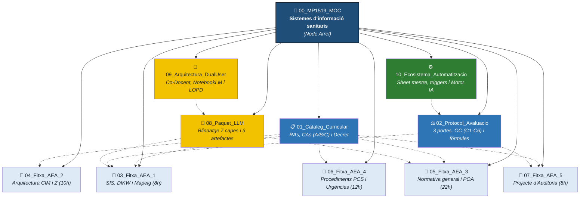

# MOC: MP 1519 — Sistemes d'informació i classificació sanitaris

> **Propòsit.** Aquest node és la porta d'entrada del mòdul professional 1519. Des d'aquí s'articula tot el graf d'aprenentatge: el catàleg de competències, el protocol d'avaluació de tres portes, el desplegament complet de les 5 Activitats d'Ensenyament-Aprenentatge (AEA) i l'ecosistema d'operació d'IA i automatització de centre.

---

## 1 · Introducció i Filosofia del Mòdul

El mòdul professional 1519, *Sistemes d'informació i classificació sanitaris*, s'imparteix al **1r curs** del cicle de grau superior de Documentació i Administració Sanitàries (SAD) i compta amb una càrrega lectiva de **99 hores totals** (66 h al centre educatiu + 33 h d'estada a l'empresa / FCT).

L'enfocament pedagògic del mòdul és el de **formar auditors d'informació clínica, no simples picadors de dades**:
* L'alumnat aprèn a analitzar l'episodi assistencial en la seva integritat, extreure els conceptes diagnòstics i terapèutics clau i codificar-los segons la normativa oficial vinculant (**CIE-10-ES 6a edició, gener 2026**).
* Cada decisió tècnica s'ensenya com un acte de responsabilitat: un error d'especificitat o una fallada en l'indicador POA desfigura el Registre d'Activitats d'Atenció Especialitzada (RAE-CMBD), altera el Grup Relacionat pel Diagnòstic (GRD) i compromet el finançament hospitalari i l'epidemiologia pública.

> ⚠️ **Frontera curricular estricta amb el MP 1520:**  
> Aquest mòdul es focalitza exclusivament en la **normativa general de codificació (Capítol A del Manual Oficial)**, l'arquitectura de navegació per la CIE-10-ES, l'indicador POA, l'estructura multiaxial de 7 caràcters de procediments (PCS) i la codificació específica base (símptomes, lesions, intoxicacions, complicacions de cures i codis Z).  
> Queda expressament exclosa la codificació de patologies específiques per aparells o sistemes, que es desenvolupa al **MP 1520** de 2n curs.

---

## 2 · Dades del Mòdul

| Camp | Valor |
|:---|:---|
| **Codi oficial** | MP 1519 |
| **Denominació** | Sistemes d'informació i classificació sanitaris |
| **Cicle formatiu** | CFGS Documentació i Administració Sanitàries (SAD) |
| **Curs acadèmic** | 1r curs |
| **Durada total** | 99 hores (66 h al centre educatiu + 33 h d'estada a l'empresa) |
| **Crèdits ECTS** | 7 crèdits |
| **Distribució lectiva** | 2 hores setmanals × 33 setmanes lectives |
| **Marc legal** | Ordre EDU/10/2020 i Reial Decret 768/2014 (LOE) |
| **Font normativa vinculant** | CIE-10-ES Diagnòstics i Procediments, 6a edició (Ministeri de Sanitat, 2026) |

---

## 3 · Resultats d'Aprenentatge (RA) i Ponderacions

El mòdul s'estructura en **8 Resultats d'Aprenentatge** oficials:

| Codi | Denominació oficial del Resultat d'Aprenentatge | Pes a la QMP | Hores lectives | AEA de referència |
|:---:|:---|:---:|:---:|:---:|
| **RA1** | Caracteritza els diferents elements que intervenen en el procés de creació d'un SIS. | 8 % | 5 h | AEA 1 |
| **RA2** | Maneja els diferents sistemes de classificacions internacionals i terminologies clíniques. | 8 % | 5 h | AEA 1 |
| **RA3** | Utilitza eficaçment les diferents parts que componen la classificació internacional de malalties. | 10 % | 6 h | AEA 2 |
| **RA4** | Selecciona els codis de la CIM, extraient prèviament l'episodi assistencial. | 10 % | 6 h | AEA 2 |
| **RA5** | Aplica la normativa establerta en matèria de codificació de dades clíniques i no clíniques. | 20 % | 12 h | AEA 3 |
| **RA6** | Duu a terme processos de codificació de diagnòstics amb la CIM vigent (normativa general). | 20 % | 12 h | AEA 3 |
| **RA7** | Duu a terme processos de codificació de procediments amb la CIM vigent (CIE-10-PCS). | 12 % | 7 h | AEA 4 |
| **RA8** | Duu a terme processos de codificació específica amb la CIM vigent (urgències i causes externes). | 12 % | 7 h | AEA 4 |
| | **Total de càrrega formativa** | **100 %** | **60 h** | *(+ 6 h recuperacions/tancament)* |

El desglossament de Criteris d'Avaluació (CAs) oficials i la seva priorització pedagògica es troben detallats a **[01_MP1519_Cataleg_Curricular.md](./01_MP1519_Cataleg_Curricular.md)**.

---

## 4 · Mapa d'Activitats d'Ensenyament-Aprenentatge (AEA)

La programació viva del mòdul es desplega a través de **5 Activitats d'Ensenyament-Aprenentatge integrades** que cobreixen la totalitat del curs:

```
Setmanes 1 a 4          Setmanes 5 a 9          Setmanes 11 a 21        Setmanes 23 a 27 + 32   Setmanes 28 a 31
┌──────────────────┐    ┌──────────────────┐    ┌──────────────────┐    ┌──────────────────┐    ┌──────────────────┐
│ AEA 1            │    │ AEA 2            │    │ AEA 3            │    │ AEA 4            │    │ AEA 5            │
│ SIS i dada       │───►│ Arquitectura CIM │───►│ Normativa i POA  │───►│ Procediments PCS │───►│ Projecte         │
│ clínica (8 h)    │    │ (10 h)           │    │ (22 h)           │    │ i causes ext.    │    │ d'Auditoria (8 h)│
│ RA1 · RA2        │    │ RA3 · RA4        │    │ RA5 · RA6        │    │ RA7 · RA8 (12 h) │    │ Tots els RA      │
└──────────────────┘    └──────────────────┘    └──────────────────┘    └──────────────────┘    └──────────────────┘
```

| AEA | Denominació i abast formatiu | Durada | RAs | Setmanes | Node de desplegament |
|:---:|:---|:---:|:---:|:---:|:---|
| **AEA 1** | **El SIS i l'estandardització de la dada clínica:** Jerarquia DIKW, CMBD, finançament per GRD, SNOMED CT vs. CIM-10-ES i l'art del mapeig. | 8 h | RA1, RA2 | 1 a 4 | **[03_MP1519_Fitxa_AEA_1.md](./03_MP1519_Fitxa_AEA_1.md)** |
| **AEA 2** | **Arquitectura de la CIE-10-ES Diagnòstics:** Indexació, termes clau, dreceres de codis Z, IAE, Llista Tabular, dummy character (X) i notes d'exclusió. | 10 h | RA3, RA4 | 5 a 9 | **[04_MP1519_Fitxa_AEA_2.md](./04_MP1519_Fitxa_AEA_2.md)** |
| **AEA 3** | **Normativa General de Diagnòstics i Indicador POA:** Definició UHDDS de Diagnòstic Principal, símptomes vs. certeses, incertesa a l'alta, consultes (Query) i marcadors POA. | 22 h | RA5, RA6 | 11 a 21 | **[05_MP1519_Fitxa_AEA_3.md](./05_MP1519_Fitxa_AEA_3.md)** |
| **AEA 4** | **Arquitectura de Procediments (PCS) i Causes Externes:** Estructura multiaxial de 7 caràcters, les 31 operacions arrel, tècniques implícites, traumatismes i intoxicacions vs. RAM. | 12 h | RA7, RA8 | 23-27 i 32 | **[06_MP1519_Fitxa_AEA_4.md](./06_MP1519_Fitxa_AEA_4.md)** |
| **AEA 5** | **Projecte Integrador (Auditoria d'Expedients Sanitaris):** Auditoria integral de casos clínics hospitalaris complexos, resolució de discrepàncies i defensa oral. | 8 h | Tots | 28 a 31 | **[07_MP1519_Fitxa_AEA_5.md](./07_MP1519_Fitxa_AEA_5.md)** |

> Les 6 hores restants de les 66 h presencials es dediquen a la recuperació contínua i tancament d'expedients (Setmanes 10, 22 i 33).

---

## 5 · Model d'Avaluació: Visió General

El mòdul s'avalua mitjançant el **model de tres portes amb llindar $\ge 5,0$**, establert al **[02_MP1519_Protocol_Avaluacio.md](./02_MP1519_Protocol_Avaluacio.md)**:

1. **Ponderació d'instruments per a cada RA:**
   $$\text{QRA} = (\text{PE} \times 0,70) + (\text{OC} \times 0,30)$$
   * **PE (70%):** Proves Escrites competencials individuals en modalitat *Open Book* amb eCIEMaps.
   * **OC (30%):** Observació Competencial continuada a l'aula, avaluada mitjançant els 6 criteris canònics (C1 Rigor tècnic, C2 Autonomia, C3 Seguretat, C4 Diligència, C5 Treball en equip, C6 Control de qualitat). L'OC es nodreix en un 70% dels dossiers de cada AEA i en un 30% del Projecte Integrador (AEA 5).

2. **Qualificació final del mòdul (QMP):**
   $$\text{QMP}_{\text{centre}} = \sum (\text{pes\_RA}_i \times \text{QRA}_i)$$
   $$\text{QMP}_{\text{final}} = (\text{QMP}_{\text{centre}} \times 0,90) + (\text{Nota\_Estada\_Empresa} \times 0,10)$$

3. **Requisit d'assoliment:** Per superar el mòdul cal una $\text{QMP}_{\text{final}} \ge 5,0$ i haver superat **tots i cadascun dels 8 RAs** ($\text{QRA} \ge 5,0$). Un RA no superat no es compensa amb les notes dels altres.

---

## 6 · El Taller Operatiu: Enginyeria d'IA i Automatització de Centre

Aquest mòdul demostra la capacitat d'OKF per operar el coneixement curricular en el dia a dia mitjançant tres eines d'enginyeria d'aula:

1. **El Paquet LLM canònic ([08_MP1519_Paquet_LLM.md](./08_MP1519_Paquet_LLM.md)):**  
   Contracte d'enginyeria de generació que incorpora les **7 capes de blindatge anti-al·lucinació**, la **Taula dels 10 Falsos Amics** (diferències entre l'ICD-10-CM americà i la CIE-10-ES espanyola) i la **regla dels 3 artefactes separats** (material d'alumne sense respostes, formulari de Classroom i solucionari).
2. **L'Arquitectura Dual-User ([09_MP1519_Arquitectura_DualUser.md](./09_MP1519_Arquitectura_DualUser.md)):**  
   Especificació per fer que qualsevol IA actuï com a co-docent amb el `SYS_PROMPT` oficial del mòdul, regles de generació de «soroll clínic», 8 prompts calibrats per a NotebookLM i el protocol de seguretat RGPD.
3. **L'Ecosistema d'Automatització ([10_MP1519_Ecosistema_Automatitzacio.md](./10_MP1519_Ecosistema_Automatitzacio.md)):**  
   Documentació de la infraestructura real que connecta el graf amb Google Workspace: el Sheet mestre de 5 pestanyes, els triggers de consolidació de formularis de múltiples grups (A i B) i el Motor IA per a l'avaluació formativa amb resolució de limitacions d'API (`@ProjectPermissionDenied`).

---

## 7 · Concrecions Organitzatives i Inclusió

* **Desdoblament de grup-classe:** S'aplica desdoblament setmanal a l'Aula d'Informàtica. Atesa la complexitat tècnica de la navegació multiaxial per eCIEMaps i la necessitat d'auditar el raonament clínic de l'alumnat cas per cas, el grup es divideix en dues meitats per garantir una ràtio reduïda.
* **Tractament de la llengua anglesa:** S'incorpora l'anglès tècnic de manera instrumental i contextualitzada, especialment en la interpretació de terminologies internacionals (SNOMED CT) i la descripció original dels sistemes DRG/GRD (Criteris d'Avaluació afegits **4g\*** i **7e\***).
* **Atenció a la diversitat (DUA):** S'apliquen mesures d'accessibilitat universal, materials d'aprenentatge en formats compatibles i una ampliació del 25% de temps en les proves competencials per a l'alumnat amb dictamen de la Comissió d'Atenció a la Diversitat (CAD).

---

## 8 · Coordinació Intermodular

El MP 1519 és la pedra angular instrumental del primer curs de SAD i manté una estreta coordinació amb la resta del cicle:

| Mòdul vinculat | Relació curricular | Flux de coordinació |
|:---|:---|:---|
| **MP 1516** (Terminologia clínica i patologia) | Coordinat (1r curs) | Aporta el vocabulari anatomofisiològic necessari per descompondre diagnòstics i identificar els termes arrel. |
| **MP 1517** (Extracció de diagnòstics i procediments) | Coordinat (1r curs) | Treballa la lectura crítica de la història clínica per identificar l'episodi assistencial que posteriorment es codifica al MP 1519. |
| **MP 1520** (Codificació sanitària avançada) | Posterior (2n curs) | El MP 1519 lliura la competència instrumental i la normativa general; el MP 1520 aborda la patologia complexa per aparells. |
| **MP 1522** (Validació i explotació de dades) | Posterior (2n curs) | Utilitza les bases de dades generades pel CMBD al MP 1519 per a l'anàlisi de casuística i qualitat assistencial. |

---

## 9 · Mapa Visual del Graf del Mòdul



---

## 10 · Relacions del Graf (Enllaços interns)

### Marc de Governança i Normatiu
- **[01_MP1519_Cataleg_Curricular.md](./01_MP1519_Cataleg_Curricular.md)** — Criteris d'Avaluació oficials, ponderacions i priorització formativa.
- **[02_MP1519_Protocol_Avaluacio.md](./02_MP1519_Protocol_Avaluacio.md)** — Fórmules de qualificació, llindars i rúbrica d'Observació Competencial.

### Desplegament d'Aula (Activitats d'Ensenyament-Aprenentatge)
- **[03_MP1519_Fitxa_AEA_1.md](./03_MP1519_Fitxa_AEA_1.md)** — AEA 1: El SIS i l'estandardització de la dada clínica (Setmanes 1 a 4).
- **[04_MP1519_Fitxa_AEA_2.md](./04_MP1519_Fitxa_AEA_2.md)** — AEA 2: Arquitectura de la CIE-10-ES Diagnòstics (Setmanes 5 a 9).
- **[05_MP1519_Fitxa_AEA_3.md](./05_MP1519_Fitxa_AEA_3.md)** — AEA 3: Normativa General de Diagnòstics i Indicador POA (Setmanes 11 a 21).
- **[06_MP1519_Fitxa_AEA_4.md](./06_MP1519_Fitxa_AEA_4.md)** — AEA 4: Arquitectura de Procediments PCS i Causes Externes (Setmanes 23 a 27 i 32).
- **[07_MP1519_Fitxa_AEA_5.md](./07_MP1519_Fitxa_AEA_5.md)** — AEA 5: Projecte Integrador d'Auditoria d'Expedients Clínics (Setmanes 28 a 31).

### El Taller Operatiu i d'Automatització
- **[08_MP1519_Paquet_LLM.md](./08_MP1519_Paquet_LLM.md)** — Contracte d'enginyeria, 7 capes anti-al·lucinació i regla dels 3 artefactes.
- **[09_MP1519_Arquitectura_DualUser.md](./09_MP1519_Arquitectura_DualUser.md)** — Manual de la IA Co-Docent, prompts per capítols de NotebookLM i protocol RGPD.
- **[10_MP1519_Ecosistema_Automatitzacio.md](./10_MP1519_Ecosistema_Automatitzacio.md)** — Arquitectura tècnica de Google Sheets Mestre, triggers de consolidació i Motor IA.
```
