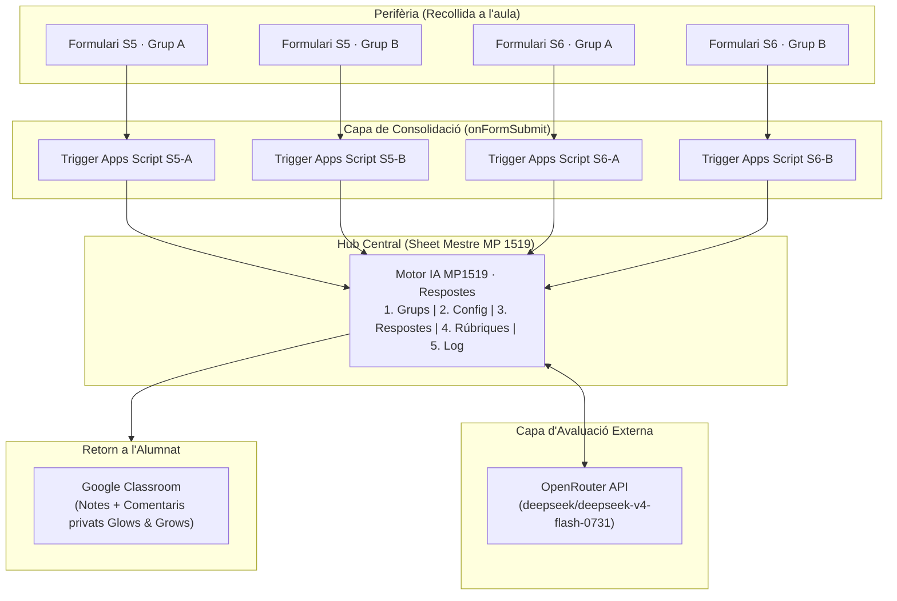

# Eina Tècnica: Ecosistema d'Automatització i Avaluació (Google Workspace + OpenRouter)

> **Propòsit.** Aquest document descriu l'enginyeria d'automatització que connecta la programació viva del MP 1519 amb les eines corporatives del centre educatiu (Google Workspace for Education). Estableix l'arquitectura distribuïda **Hub-Spoke** per centralitzar les respostes de múltiples grups, la mitigació de les limitacions de Google Apps Script (límit de 20 triggers per usuari) i el funcionament del **Motor IA d'Avaluació**, resolent de manera pragmàtica el bloqueig de permisos de l'API de Classroom (`@ProjectPermissionDenied`).

---

## 1 · Filosofia del Pont Institucional

A l'arquitectura d'OKF no caiem en el parany del purisme tecnològic aïllacionista:
* **A la nostra màquina (la font de veritat):** Treballem amb text pla sobirà (Markdown + YAML) sota control de versions Git, garantint la independència de la nostra feina.
* **A la sortida cap al centre (el pont institucional):** Ens adaptem a l'ecosistema triat per la comunitat educativa (Google Workspace i Classroom), actuant com un *driver* de sortida que estalvia centenars d'hores de gestió manual.

```
┌────────────────────────────────────────────────────────────────────────┐
│  GRAF OKF EN TEXT PLA (Font de veritat sobirana al disc dur)           │
└───────────────────────────────────┬────────────────────────────────────┘
                                    │ Generació de formularis i rúbriques
                                    ▼
┌────────────────────────────────────────────────────────────────────────┐
│  ECOSISTEMA GOOGLE WORKSPACE FOR EDUCATION                             │
│  • Google Forms (Recollida setmanal descentralitzada)                  │
│  • Google Sheets Mestre (Consolidació automàtica via onFormSubmit)     │
│  • Motor IA en Apps Script (Avaluació via OpenRouter DeepSeek)         │
│  • Google Classroom (Retorn de notes i comentaris Glows & Grows)       │
└────────────────────────────────────────────────────────────────────────┘
```

---

## 2 · Arquitectura Distribuïda Hub-Spoke

### 2.1 · El problema estructural de Google Forms
Google Forms té una restricció de disseny: **no permet vincular múltiples formularis a un mateix full de càlcul de respostes de manera nativa**. Cada cop que es crea un formulari setmanal per a un grup (per exemple, Setmana 5 Grup A i Setmana 5 Grup B), Google genera un full de càlcul independent. Al final d'un curs de 33 setmanes amb 2 grups, el docent es troba amb 66 fulls dispersos al Drive.

### 2.2 · La solució: El model Hub-Spoke
L'arquitectura del MP 1519 resol aquest problema creant una topologia en estrella:



1. **La Perifèria (Spokes):** Cada formulari setmanal desa les respostes al seu full individual d'arxiu.
2. **El Trigger (`CONSOLIDACIO.gs`):** En enviar-se una resposta, s'executa un trigger automàtic `onFormSubmit` que extreu les dades, les valida contra duplicats i les injecta a l'únic **Sheet Mestre**.
3. **El Hub:** Totes les respostes del curs (més de 1.500 registres) s'ordenen en una sola taula centralitzada a punt per ser avaluades.

---

## 3 · Estructura del Sheet Mestre (5 Fulls)

El document central de càlcul s'anomena `Motor IA MP1519 · Respostes` i conté exactament **5 pestanyes**:

```text
┌────────────────────────────────────────────────────────┐
│ Motor IA MP1519 · Respostes                            │
├─────────┬──────────┬─────────────┬─────────────┬───────┤
│  Grups  │  Config  │  Respostes  │  Rúbriques  │  Log  │
└─────────┴──────────┴─────────────┴─────────────┴───────┘
```

### 3.1 · Full `Grups` (Configuració dels Cursos)
Associa cada grup d'alumnes amb el seu identificador únic de Google Classroom:

| Columna | Nom del camp | Tipus | Contingut d'exemple |
|:---:|:---|:---|:---|
| **A** | Grup | Text | `A` o `B` |
| **B** | Course ID | Text numèric | `875757984898` (ID intern de Classroom) |
| **C** | Nom | Text | `MP 1519 DAS1 A 26-27` |

### 3.2 · Full `Config` (Registre de Tasques i Formularis)
Controla la traçabilitat de totes les activitats generades al llarg de les 33 setmanes:
* **Columnes A-G:** `Setmana` (núm.), `Grup` (A/B), `Form ID` (identificador del formulari), `Form URL` (enllaç públic), `Spreadsheet ID` (full individual), `Trigger ID` (identificador del disparador) i `CourseWork ID` (tasca a Classroom).
* Permet al sistema saber automàticament a quina setmana i grup pertany cada resposta que arriba.

### 3.3 · Full `Respostes` (La Matriu d'Avaluació de 17 Columnes)
És la taula central del curs. El seu ordre de columnes és **inviolable**, atès que el codi d'Apps Script llegeix i escriu per índex absolut:

| Col. | Nom de columna | Amplada | Responsable d'escriptura | Contingut |
|:---:|:---|:---:|:---|:---|
| **A** | Timestamp | 140 px | `CONSOLIDACIO.gs` | Data i hora exacta de lliurament del formulari. |
| **B** | Email | 200 px | `CONSOLIDACIO.gs` | Correu corporatiu oficial de l'alumne. |
| **C** | Grup | 60 px | `CONSOLIDACIO.gs` | `A` o `B`. |
| **D** | Setmana | 70 px | `CONSOLIDACIO.gs` | Número de setmana lectiva (`5`, `6`...). |
| **E** | Cognoms i Nom | 180 px | `CONSOLIDACIO.gs` | Nom complet de l'estudiant. |
| **F** | NIA | 100 px | `CONSOLIDACIO.gs` | Número d'Identificació de l'Alumne (expedient). |
| **G** | **Respostes_Curtes** | 300 px | `CONSOLIDACIO.gs` | JSON empaquetat: `{"P1":"...","P2":"...","P3":"...","P4":"..."}`. |
| **H** | **Resposta_Pràctica**| 400 px | `CONSOLIDACIO.gs` | Text complet del raonament del cas clínic (P5). |
| **I** | Nota_Curtes | 90 px | `MOTOR_IA.gs` | Nota obtinguda a les preguntes curtes (base 10). |
| **J** | Nota_Pràctica | 100 px | `MOTOR_IA.gs` | Nota obtinguda al cas pràctic (base 10). |
| **K** | **Nota_Total** | 90 px | `MOTOR_IA.gs` | **Nota final ponderada:** $(\text{Nota}_I \times 0,30) + (\text{Nota}_J \times 0,70)$. |
| **L** | Glows | 250 px | `MOTOR_IA.gs` | Punts forts destacats per la IA en llenguatge positiu. |
| **M** | Grows | 250 px | `MOTOR_IA.gs` | Àrees concretes de millora i advertències normatives. |
| **N** | **Comentari** | 400 px | `MOTOR_IA.gs` | Retorn complet maquetat llest per a l'alumne. |
| **O** | Publicar | 80 px | Docent (manual) | Casella de verificació (Checkbox) per aprovar la publicació. |
| **P** | **Estat** | 100 px | Sistema / Docent | `pendent` $\rightarrow$ `avaluat` $\rightarrow$ `publicat` (o `error`). |
| **Q** | Data_Avaluació | 140 px | `MOTOR_IA.gs` | Marca de temps en què la IA va emetre el dictamen. |

### 3.4 · Full `Rúbriques` (Instruccions de Correcció per Setmana)
Emmagatzema dues files per setmana: una per a la rúbrica de preguntes curtes (`CURTES`) i una altra per al cas pràctic (`PRACTICA`). Això permet modificar els criteris d'avaluació sense haver d'editar mai el codi font dels scripts.

### 3.5 · Full `Log` (Auditoria i Telemetria del Sistema)
Registra cada esdeveniment amb les columnes: `Data`, `Acció` (`OK`, `DUPLICAT` o `ERROR`), `Setmana`, `Grup` i `Detalls`. Si un alumne afirma haver entregat una tasca que no apareix a la llista, el docent cerca el seu correu al `Log` en 5 segons.

---

## 4 · El Sistema de Consolidació (`CONSOLIDACIO.gs`)

### 4.1 · Extracció neta i serialització en JSON
Per evitar haver d'afegir columnes noves al full cada vegada que un exercici té més o menys preguntes, el trigger agrupa totes les respostes teòriques en un objecte JSON a la columna G:
```javascript
// Dins de CONSOLIDACIO.gs
const matchPreg = titol.match(/^(P\d+)\)/i);
if (matchPreg) {
  const idPreg = matchPreg[1].toUpperCase();
  if (idPreg === 'P5' || /CAS PRÀCTIC/i.test(titol)) {
    dades.practica = resposta; // Columna H
  } else {
    dades.curtes[idPreg] = resposta; // Columna G en format JSON
  }
}
```

### 4.2 · Control rigorós de duplicats
Abans d'afegir una fila nova, el trigger comprova si ja existeix un registre amb la mateixa terna: `(Email, Setmana, Grup)`. Si un alumne torna a enviar el formulari, el sistema registra l'acció com a `DUPLICAT` al `Log` i bloqueja la sobreescriptura per evitar fraus o desordres.

### 4.3 · Mitigació del límit crític de 20 triggers de Google
* **La restricció de Google:** Google Apps Script permet un **màxim absolut de 20 triggers instal·lats per usuari**.
* **El problema:** En un curs de 33 setmanes amb 2 grups, es necessitarien $33 \times 2 = 66$ triggers. A la Setmana 10 el sistema col·lapsaria silenciosament.
* **La solució d'enginyeria:**
  1. Els triggers només s'instal·len sobre les setmanes actives.
  2. Un cop tancada una fita d'avaluació (ex: Fita 1 a la Setmana 4), s'executa la neteja de triggers antics, alliberant espai per a les setmanes següents.
  3. El sistema mai supera una finestra de 6 a 8 triggers simultanis actius.

---

## 5 · El Motor d'Avaluació IA (`MOTOR_IA.gs` v6.0)

El Motor IA s'executa a demanda des del menú personalitzat de Google Sheets (*Motor IA $\rightarrow$ 1. Avaluar Respostes Obertes*):

1. **Crida externa a OpenRouter:** Connecta via API amb el model `deepseek/deepseek-v4-flash-0731` utilitzant una temperatura ultra-baixa (`0.1`) per garantir la màxima consistència i repetibilitat de les qualificacions.
2. **Pseudonimització prèvia:** Abans d'enviar el text de l'alumne a la xarxa, el script esborra qualsevol patró de nom, correu o telèfon.
3. **Injecció de la Micro-Rúbrica:** La IA rep el text de l'alumne juntament amb la rúbrica oficial de la setmana i retorna una qualificació analítica acompanyada d'un retorn pedagògic estructurat:
   * **Glows (🌟 Punts forts):** Allò que l'alumne ha resolt amb precisió normativa.
   * **Grows (🌱 Aspectes a millorar):** Conceptes o paranys d'índex que cal repassar.

---

## 6 · La Resolució de la Restricció `@ProjectPermissionDenied`

### 6.1 · El bloqueig de seguretat de Google Classroom
Quan es va intentar fer que el Motor IA pugés les notes directament a Google Classroom mitjançant l'API oficial (`Classroom.Courses.CourseWork.StudentSubmissions.patch()`), Google va bloquejar l'operació amb l'error:
```text
@ProjectPermissionDenied: The Developer Console project is not permitted to make this request.
```
Aquesta política de Google impedeix que un script modifiqui tasques de Classroom si la tasca no va ser creada pel mateix projecte exacte de Cloud (per exemple, si el professor va crear la tasca manualment al navegador web).

### 6.2 · La solució: La interfície modal de còpia ràpida en un clic
En lloc de dependre d'una API corporativa hostil, es va dissenyar la funció `mostrarComentarisPerCopiar()`. 

El docent obre *Motor IA $\rightarrow$ 2. Mostrar Comentaris per Copiar* i se li desplega un diàleg HTML interactiu:

```text
┌────────────────────────────────────────────────────────────────────────┐
│  COMUNICACIÓ D'AVALUACIÓ — CLASSROOM                                    │
│  Fila 14 · alumne@centre-educatiu.cat                                  │
│                                                                        │
│  Nota Final:  [  8.5  ]  ◄── Clic: es copia al porta-retalls           │
│                                                                        │
│  Comentari:   [ PUNTS FORTS (Glows):                                ]  │
│               [ • Extreu correctament el Terme Principal.           ]  │
│               [ ASPECTES A MILLORAR (Grows):                        ]  │
│               [ • Has oblidat verificar la nota Excluye 1 a la LT.  ]  │
│               ▲                                                        │
│               └──────── Clic: es copia al porta-retalls                │
└────────────────────────────────────────────────────────────────────────┘
```

* **Ergonomia docent:** El professor té el Classroom obert a la pantalla esquerra i el diàleg a la dreta.
* Fa un clic a la nota $\rightarrow$ s'enganxa a Classroom.
* Fa un clic al comentari $\rightarrow$ s'enganxa al comentari privat.
* **Temps per alumne:** Menys de 15 segons, amb **supervisió humana total (MIAE 3)** i sense errors de permisos.

---

## 7 · Cicle de Manteniment i Protocols de Backup

| Periodicitat | Tasca operativa obligatòria |
|:---|:---|
| **Setmanal** | Comprovar que les respostes noves entren amb `Estat=pendent`; executar el Motor IA i revisar notes a la columna K. |
| **Cada 3 setmanes** | Executar la neteja de triggers de formularis tancats per mantenir-se per sota del límit de 20. |
| **Mensual** | Exportar el full `Log` a CSV i buidar-lo; fer una còpia de seguretat completa del Sheet mestre (`Fitxer → Feu una còpia`) a la carpeta `_backups/`. |
| **Final de curs** | Descarregar la taula de `Respostes` completa en format CSV com a arxiu acadèmic oficial del mòdul i buidar el full per a la promoció següent. |

---

## 8 · Relacions del Graf (Enllaços interns)

- **[00_MP1519_MOC.md](./00_MP1519_MOC.md)** — Node arrel i mapa general del mòdul.
- **[02_MP1519_Protocol_Avaluacio.md](./02_MP1519_Protocol_Avaluacio.md)** — Regles de qualificació i micro-rúbrica de 2 punts executada pel Motor IA.
- **[08_MP1519_Paquet_LLM.md](./08_MP1519_Paquet_LLM.md)** — Contracte d'IA que genera les estructures de preguntes per al `Config`.
- **[09_MP1519_Arquitectura_DualUser.md](./09_MP1519_Arquitectura_DualUser.md)** — Manual de la IA Co-Docent i protocol de protecció de dades RGPD.
- **[10_MP1519_Validador_CIE10ES.md](./10_MP1519_Validador_CIE10ES.md)** — Eina determinista que audita els codis abans de carregar-los a les rúbriques del Sheet.
```
