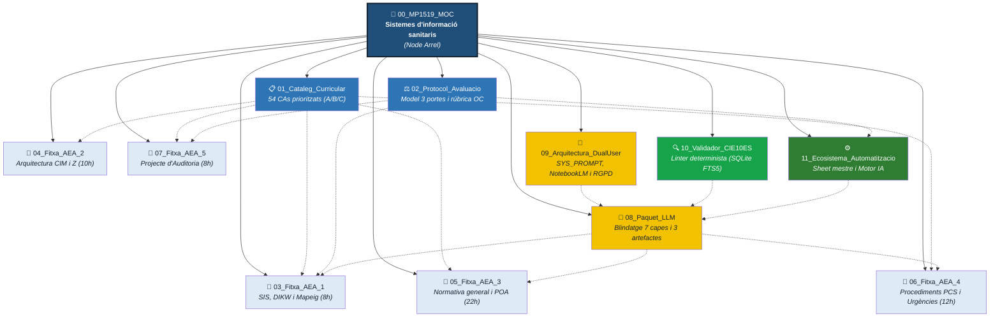

# `02-exemple-complet/README.md` — fitxer complet amb el DOI afegit

**Instruccions:** substitueix **tot** el contingut actual de `02-exemple-complet/README.md` per aquest. Els canvis principals:
- **DOI a la capçalera** (just després de la introducció).
- **Actualització del validador** a la secció 4: `v1.0.1` → `v1.0.2` (és la versió actual).
- **DOI a la secció 6** (Llicència).
- **Nota menor:** he afegit una línia a la secció 4 explicant que el validador ara exclou `00-documentacio/` i `06-comunitat/`, per si algú es pregunta per què el recompte de nodes és diferent.

```markdown
# MP 1519 — Exemple Complet de Desplegament OKF

> **Mòdul Professional 1519: Sistemes d'informació i classificació sanitaris**  
> *Cicle Formatiu de Grau Superior en Documentació i Administració Sanitàries (SAD) — Marc LOE*

Aquest directori conté el **vaixell insígnia d'OKF Starter Kit**: un mòdul professional complet de 99 hores lectives desenvolupat de manera exhaustiva en un graf de text pla i metadades YAML.

**DOI del projecte:** [10.5281/zenodo.23823819](https://doi.org/10.5281/zenodo.23823819) · **Repositori:** [github.com/jmonta23-okf/okf-starter-kit](https://github.com/jmonta23-okf/okf-starter-kit)

Lluny de ser una maqueta teòrica o un resum esquemàtic, aquest exemple recull el desplegament complet de la programació viva d'aula (les 5 de 5 AEAs), el model d'avaluació de tres portes, el blindatge anti-al·lucinació de la CIE-10-ES (6a edició, gener 2026), l'arquitectura de la IA Co-Docent i la integració pragmàtica amb l'ecosistema tecnològic de centre (Google Workspace for Education).

---

## 1 · Mapa dels 11 Nodes Canònics

Tots els fitxers d'aquest mòdul respecten estrictament els **15 tipus de nodes permesos** per la Convenció de Nomenclatura d'OKF i se sotmeten a la validació estàtica de `validar_yaml.py`:

| # | Fitxer | Tipus OKF | Descripció i abast pedagògic |
|:---:|:---|:---:|:---|
| **00** | **[00_MP1519_MOC.md](./00_MP1519_MOC.md)** | `MOC` | **Node arrel del mòdul:** Dades administratives, pesos dels 8 RAs, mapa de les 5 AEAs, desdoblaments d'aula d'informàtica i coordinació intermodular. |
| **01** | **[01_MP1519_Cataleg_Curricular.md](./01_MP1519_Cataleg_Curricular.md)** | `CatalegCurricular` | **Marc normatiu:** Ordre EDU/10/2020 i RD 768/2014. Desglossament complet dels 54 CAs oficials amb doble codificació (numèrica i guia) i priorització formativa (Nivells A, B, C). |
| **02** | **[02_MP1519_Protocol_Avaluacio.md](./02_MP1519_Protocol_Avaluacio.md)** | `Protocol` | **Sistema d'avaluació:** Model de tres portes amb llindar $\ge 5,0$, ponderació PE (70%) i OC (30%), matriu de rúbrica C1-C6, micro-rúbrica de 2 punts i recuperació contínua. |
| **03** | **[03_MP1519_Fitxa_AEA_1.md](./03_MP1519_Fitxa_AEA_1.md)** | `FitxaAEA` | **AEA 1 (Setmanes 1 a 4 · 8h):** El SIS, la piràmide DIKW (dada òrfena), el CMBD, finançament per GRD, SNOMED CT vs. CIM-10-ES, mapeig 1:1, 1:N, N:1 i Casos Oberts 1 i 2. |
| **04** | **[04_MP1519_Fitxa_AEA_2.md](./04_MP1519_Fitxa_AEA_2.md)** | `FitxaAEA` | **AEA 2 (Setmanes 5 a 9 · 10h):** Arquitectura de diagnòstics, termes clau, 5 dreceres de codis Z, Taula de Neoplàsies, navegació IAE, Llista Tabular, dummy character X, exclusions i Casos 3 i 4. |
| **05** | **[05_MP1519_Fitxa_AEA_3.md](./05_MP1519_Fitxa_AEA_3.md)** | `FitxaAEA` | **AEA 3 (Setmanes 11 a 21 · 22h):** Normativa general, definició UHDDS de Diagnòstic Principal, incertesa, empat clínic, cirurgies suspeses, marcadors POA (S, N, D, I, E), Query i Cas 5. |
| **06** | **[06_MP1519_Fitxa_AEA_4.md](./06_MP1519_Fitxa_AEA_4.md)** | `FitxaAEA` | **AEA 4 (Setmanes 23 a 27 + 32 · 12h):** Procediments PCS multiaxials de 7 caràcters, 31 operacions arrel, tècniques implícites B3.1b, convertits, lesions, efecte mirall i Intoxicació vs. RAM (Casos 6, 7 i 8). |
| **07** | **[07_MP1519_Fitxa_AEA_5.md](./07_MP1519_Fitxa_AEA_5.md)** | `FitxaAEA` | **AEA 5 (Setmanes 28 a 31 · 8h):** Projecte Integrador d'Auditoria Clínica d'Expedients Sanitaris (comissió d'auditoria de 3 casos complexos, impacte en GRD, defensa oral i contra-auditoria). |
| **08** | **[08_MP1519_Paquet_LLM.md](./08_MP1519_Paquet_LLM.md)** | `PaquetLLM` | **Contracte d'enginyeria d'IA:** 7 capes anti-al·lucinació, Taula dels 10 Falsos Amics (CIE-10-ES vs. ICD-10-CM), regla dels 3 artefactes separats i compliment MIAE 3 + VCER. |
| **09** | **[09_MP1519_Arquitectura_DualUser.md](./09_MP1519_Arquitectura_DualUser.md)** | `Guia` | **Manual de la IA Co-Docent:** SYS_PROMPT oficial, regles pedagògiques de soroll clínic, 8 prompts calibrats per a NotebookLM i protocol de protecció de dades RGPD. |
| **10** | **[10_MP1519_Validador_CIE10ES.md](./10_MP1519_Validador_CIE10ES.md)** | `EinaTecnica` | **Validador de Domini determinista:** Documentació de `cie10es_validator.py` (Python + SQLite FTS5) per verificar codis contra la base de dades oficial del Ministeri de Sanitat (zero al·lucinacions). |
| **11** | **[11_MP1519_Ecosistema_Automatitzacio.md](./11_MP1519_Ecosistema_Automatitzacio.md)** | `EinaTecnica` | **Integració de centre (Google Workspace):** Arquitectura Hub-Spoke de 5 fulls a Google Sheets, triggers `onFormSubmit` (límit de 20 triggers) i Motor IA amb solució a `@ProjectPermissionDenied`. |

---

## 2 · Topologia del Graf

El mòdul no s'estructura en un calaix desordenat de fitxers, sinó en una xarxa neuronal de dependències pedagògiques i tècniques:



---

## 3 · Els Quatre Pilars que Fan Únic Aquest Desplegament

### 1. La Programació Viva Completa (Sense dreceres)
A diferència de molts models curriculars que només esbossen una o dues unitats a mode d'exemple, aquí estan redactades **les 5 de 5 Activitats d'Ensenyament-Aprenentatge (AEA)**, sumant exactament les 60 hores lectives presencials més les 6 hores de recuperació contínua i tancament d'actes. Cada fitxa integra el marc teòric, els casos clínics reals d'Aprenentatge Basat en Problemes (ABP) resolts, les bateries d'activitats d'aula i la seqüenciació minutada sessió per sessió.

### 2. El Taller Operatiu d'Intel·ligència Artificial (MIAE 3 + VCER)
El node `08_MP1519_Paquet_LLM.md` demostra com un docent pot operar amb models de llenguatge sense perdre el control ètic ni pedagògic:
* **Marc MIAE (Nivell 3):** Cap material summativa ni cap decisió clínica es deixa a l'autonomia de la màquina; la IA proposa l'esborrany sobre les dades del graf i el docent audita sempre el resultat.
* **Avaluació VCER:** Les presentacions i materials derivats funcionen **100% offline**, sense telemetria, respectant escrupolosament la privacitat de l'alumnat i amb accessibilitat universal per teclat.
* **La Regla dels 3 Artefactes:** Separació estricta entre el material d'alumne amb taules buides, el formulari de recollida de preguntes conceptuals i el solucionari justificat, evitant filtracions de respostes a l'aula.

### 3. El Validador de Domini Determinista (`cie10es_validator.py`)
El node `10_MP1519_Validador_CIE10ES.md` estableix un salt de qualitat cabdal:
* `validar_yaml.py` comprova l'estructura i sintaxi del graf.
* `cie10es_validator.py` comprova la veracitat mèdica dels codis contra la base de dades oficial SQLite del Ministeri de Sanitat (`cie10es.db`), eliminant les al·lucinacions per disseny mitjançant comprovacions deterministes en menys d'un segon.

### 4. La Integració de Trinxera amb les Eines de Centre
El node `11_MP1519_Ecosistema_Automatitzacio.md` resol la tensió entre la sobirania del text pla i la burocràcia corporativa:
* Connecta el graf amb Google Workspace for Education mitjançant una arquitectura **Hub-Spoke** (centralitzant en un sol Sheet mestre les respostes de múltiples formularis de grups A i B).
* Gestiona els límits d'infraestructura (màxim de 20 triggers a Apps Script).
* Resol amb una interfície de còpia ràpida en un clic el bloqueig de permisos corporatius de la Classroom API (`@ProjectPermissionDenied`).

---

## 4 · Com Validar Aquest Exemple

Tot aquest directori està dissenyat per passar la validació automàtica del Starter Kit sense un sol error. Des de l'arrel del repositori:

```bash
python3 03-eines/validar_yaml.py --ruta 02-exemple-complet
```

**Sortida esperada al terminal:**
```text
# Informe de Validació YAML — OKF Starter Kit
**Ruta del vault:** 02-exemple-complet
**Script:** validar_yaml.py v1.0.2

## Resum Executiu

| Mètrica | Valor |
|:--------|:-----:|
| Fitxers .md escanejats (nodes OKF) | 11 |
| Fitxers amb errors | 0 |
| Errors crítics (🔴) | 0 |
| Errors alts (🟠) | 0 |
| Advertències (🟡) | 0 |

## ✅ Resultat
Tots els nodes OKF del vault han passat la validació sense errors.
```

**Nota:** el validador v1.0.2 exclou les carpetes `00-documentacio/` i `06-comunitat/` de la validació (perquè són documents humans, no nodes OKF). Per això el recompte de nodes és lleugerament diferent de la versió anterior.

---

## 5 · Itineraris d'Exploració Recomanats

Depenent del teu perfil o interès, et recomanem seguir aquests camins de lectura:

* 🧭 **Ruta Pedagògica i Curricular (Vull veure com s'estructura un curs de FP):**  
  Comença pel MOC arrel **[00](./00_MP1519_MOC.md)** $\rightarrow$ consulta els CAs prioritzats a **[01](./01_MP1519_Cataleg_Curricular.md)** $\rightarrow$ entén el model de tres portes a **[02](./02_MP1519_Protocol_Avaluacio.md)** $\rightarrow$ explora el desplegament d'aula a les fitxes d'activitat **[03](./03_MP1519_Fitxa_AEA_1.md)** fins a **[07](./07_MP1519_Fitxa_AEA_5.md)**.

* 🤖 **Ruta del Taller i l'Enginyeria d'IA (Vull veure com s'opera el graf sense al·lucinacions):**  
  Analitza el contracte mestre a **[08](./08_MP1519_Paquet_LLM.md)** (atenció a la Taula dels 10 Falsos Amics) $\rightarrow$ llegeix el manual de la IA Co-Docent a **[09](./09_MP1519_Arquitectura_DualUser.md)** $\rightarrow$ descobreix el linter determinista local a **[10](./10_MP1519_Validador_CIE10ES.md)**.

* ⚙️ **Ruta d'Automatització i Centre (Vull veure com connecta amb Google Classroom i Sheets):**  
  Ves directament a **[11](./11_MP1519_Ecosistema_Automatitzacio.md)** per veure com gestionar la recollida distribuïda de formularis i el retorn de qualificacions Glows & Grows.

---

## 6 · Nota de Privacitat i Llicència

Totes les dades d'aquest exemple han estat higienitzades i neutralitzades:
* Els identificadors de pacients, números d'episodi mèdic i centres educatius són ficticis i d'ús estrictament docent.
* Els marcs normatius legals (LOE) i clínics (CIE-10-ES 6a edició) són reals i oficials.
* **Llicència:** Tot el contingut pedagògic d'aquest exemple es distribueix sota la llicència lliure **Creative Commons Reconeixement-CompartirIgual 4.0 (CC BY-SA 4.0)**. El projecte complet té DOI permanent: [10.5281/zenodo.23823819](https://doi.org/10.5281/zenodo.23823819).
```
